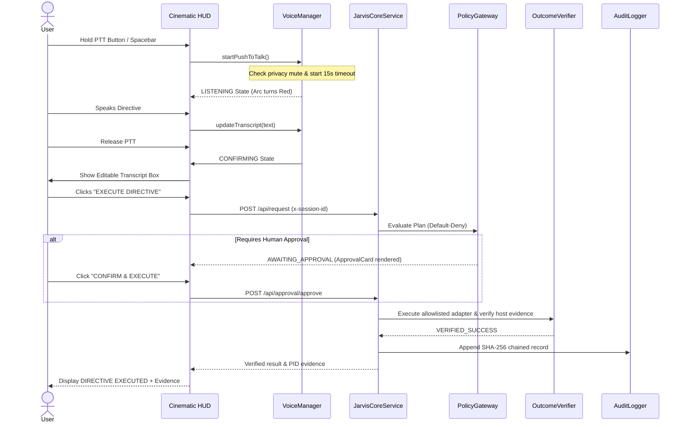
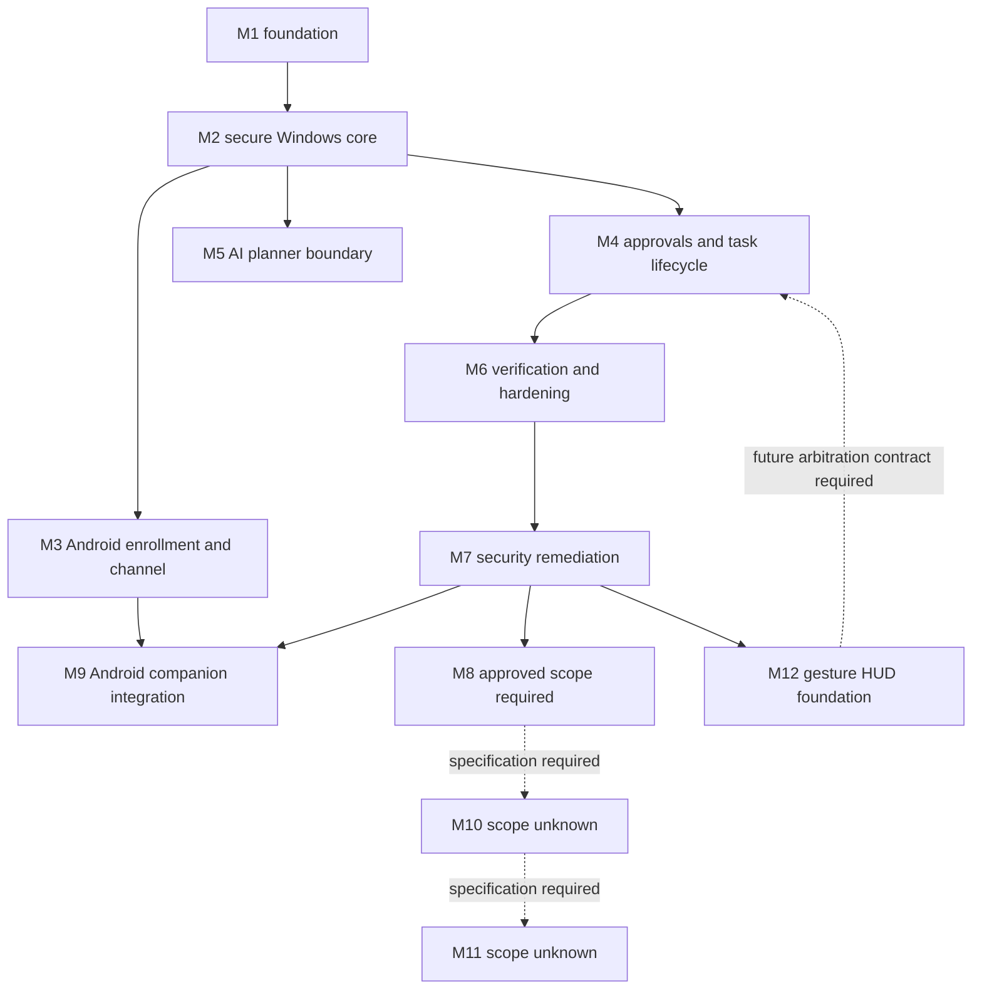

# JARVIS Consolidated Repository Documentation

**Purpose:** A single, searchable reference combining the tracked project Markdown documents, with a reconciled overview followed by the complete source material.

**Consolidation scope:** Tracked project Markdown under `docs/`, excluding files whose basename is `README.md`, plus the existing root-level documents explicitly excluded by the requester. No Word documents were present in the tracked repository. Dependency documentation under `node_modules` is not project documentation and is not part of this consolidation.

**Important:** This document consolidates evidence and plans recorded on different dates and branches. It does not represent a fresh test run, release approval, or claim that historical results apply to the current checkout. Source sections are retained in full below the overview so that detailed evidence and historical context are not lost.

## Contents

1. [Executive overview](#executive-overview)
2. [System architecture and security model](#system-architecture-and-security-model)
3. [Milestone status and acceptance](#milestone-status-and-acceptance)
4. [Verification evidence and limitations](#verification-evidence-and-limitations)
5. [Outstanding risks and acceptance gates](#outstanding-risks-and-acceptance-gates)
6. [M12 gesture foundation](#m12-gesture-foundation)
7. [Consolidated source documents](#consolidated-source-documents)

## Executive overview

JARVIS is a local-first personal assistant proof of concept built around a TypeScript/Node.js host, a browser-based companion/HUD, and narrowly allowlisted Windows operations. The architecture is designed so that user text, speech transcripts, companion requests, and AI planner proposals are untrusted inputs; none carries execution authority by itself.

The documented request lifecycle is:

> Authenticate → understand and plan → validate the proposal → evaluate policy → obtain task-scoped human approval when required → execute a bounded adapter → verify observable results → append an audit record → report the evidence honestly.

The repository documentation records substantial local implementation and test work, but repeatedly classifies integrated release readiness as **BLOCKED / NOT READY**. Important external or incomplete gates include exact-source hosted CI, target-owner Windows acceptance, physical microphone/vendor behavior, native Android and two-phone validation, complete API/accessibility coverage, and approved specifications for milestones whose scope is not documented. Gesture tracking remains a local, opt-in, preview-only foundation; it is not an execution or approval path.

### Reading status and historical evidence

- Milestone reports refer to different branches, commits, and working-tree states. Do not combine their test counts as though they came from one immutable source revision.
- The M1–7 reports describe local checks on a `fix` tree based on commit `9ead85cdacb7e9dedf855605a6d0942760ea3a6f`; some reports note uncommitted test-harness and documentation changes.
- M12 reports describe a separate `new` branch snapshot, including commit `542692b515b12fa2a2a536c0a34a3d8e4b02123a`, and explicitly record two full-suite failures in that snapshot.
- These are historical document statements, not results from this consolidation task. No build or tests were run while preparing this document.

## System architecture and security model

### Technology and components

- **Host:** Node.js v24 and TypeScript modular monolith.
- **Core services:** identity/session management, policy gateway, planner boundary, bounded Windows adapters, outcome verifier, audit logger, and HTTP server.
- **Companion:** responsive browser/PWA-oriented interface intended for mobile access; it is not equivalent to a native Android application or hardware-backed Android Keystore.
- **HUD and voice:** browser-based Windows HUD with explicit push-to-talk, transcript review, text fallback, and accessibility controls.
- **Persistence:** device/revocation state and audit evidence are persisted locally; security-sensitive operations must fail closed if state or audit integrity cannot be trusted.
- **Gesture foundation:** opt-in camera and local worker inference, isolated from server, identity, policy, and adapters; gestures produce bounded visual previews only.

### Non-negotiable security invariants

1. **Default deny:** every operation must map to an explicit permission and scope; unknown operations, extra parameters, and scope expansion are rejected.
2. **Untrusted planner:** AI may propose schema-validated plans but cannot authorize, elevate permissions, edit policy, or call adapters.
3. **Authenticated device identity:** companion identities use Ed25519 keys; enrollment is owner-authorized, short-lived, single-use, and proof-of-possession bound. Requests are session-bound, fresh, signed, and replay-protected.
4. **Task-scoped approval:** state-changing operations require explicit, expiring, single-use approval bound to the task and exact operation/target/parameters.
5. **Bounded execution:** only registered allowlisted adapters may run. No shell interpolation, arbitrary command execution, or administrator elevation is permitted.
6. **Outcome verification:** process launch or successful return code alone is not proof of the intended result. Uncertain or partial results must never be represented as verified success.
7. **Tamper-evident audit:** records are hash chained; integrity failures block state-changing execution. Secrets, signatures, tokens, and private keys must not appear in logs, audit records, or responses.
8. **Privacy by explicit activation:** microphone capture is push-to-talk only; camera capture is opt-in and video-only. No wake-word listening or background camera capture is intended.
9. **No gesture authority:** hand tracking cannot approve, execute, delete, invoke APIs, control the desktop, or bypass authentication/policy.
10. **Excluded operations:** financial actions, broad file modification, unrestricted shells, and UAC/admin elevation remain out of scope.

### Signed request and recovery model

The documented canonical request signature covers the HTTP method, path, session identifier, timestamp, nonce, and SHA-256 body digest. Freshness, nonce replay, signature integrity, active session, device revocation, persisted state, and audit-chain integrity are checked before protected work. Device revocation persists across restarts; ephemeral sessions do not. Corrupt identity state, failed persistence, broken audit chains, or interrupted execution must surface an explicit degraded/uncertain state and fail closed where required.

## Milestone status and acceptance

| Area | Consolidated documented status | Important boundary |
|---|---|---|
| M1 — Foundation | Reported verified on the documented local Windows/Node environment | Does not certify later or different source snapshots. |
| M2 — Secure Windows core | Partial | Read-only probes and a Notepad approval path were exercised; all targets and owner-device acceptance were not. |
| M3 — Enrollment and companion channel | Blocked / partial | Browser cryptography is not native Android Keystore acceptance; two physical phones and trusted remote transport are outstanding. |
| M4 — Approval and task lifecycle | Partial | Core lifecycle tests exist; real adapter interruption and side-effect reconciliation remain unverified. |
| M5 — Planner integration | Partial | Local planner boundary and adversarial schema tests exist; broad intent quality and external provider integration are not established. |
| M6 — Verification and hardening | Partial | Reports show local test evidence, but performance evidence and Linux/WSL runtime verification are incomplete. |
| M7 — Security remediation | Blocked / not complete | Local remediation evidence exists, but exact-source hosted CI and external/device acceptance remain gates. |
| M8 | Unverified / blocked | Approved scope and discovery decisions were not found in the inspected snapshots. |
| M9 — Android integration | Partial / blocked | Historical Kotlin prototype was isolated from the `fix` backend, unbuilt, and lacked required mobile/TLS APIs. Later repository notes state the prior checkout was absent; reconcile with the owner before restoring anything. |
| M10–M11 | Scope unknown | Do not infer requirements or create milestone worktrees without approved specifications. |
| M12 — Gesture/spatial foundation | Partial | Camera/landmark preview is opt-in and local; physical accuracy/performance acceptance and all action integration are outstanding. |

The milestone dependency map records M1→M2, M2→M3/M4/M5, M4→M6, M6→M7, M3+M7→M9, M7→M8, and M7→M12. M8, M10, and M11 remain placeholders pending approved scope. Future gesture action integration depends on explicit arbitration and the existing authentication, policy, approval, verification, and audit contracts.

## Verification evidence and limitations

The M1–7 documents report, for their particular tested `fix` snapshots:

- `npm ci`, build, lint/type-check, `npm test` (51 passed, 0 failed, 0 skipped), browser smoke, dependency resolution, and an npm audit with zero reported vulnerabilities.
- Microsoft Edge browser smoke with simulated speech recognition and an intercepted uncertain approval response.
- Windows read-only OS, memory, battery, and C: drive probes, plus a Notepad approval/launch flow.
- Regression coverage for enrollment authorization, signed sessions, API validation, approval binding/replay, audit integrity/redaction, private dispatch, outcome reporting, and HUD XSS/CSP behavior.

Those reports also identify limits: tests used a dirty tree based on a commit rather than an immutable tested-source commit; hosted CI could not be authenticated/verified; microphone/vendor behavior was simulated; Android build/device and two-phone tests were unavailable; WSL lacked a Linux Node runtime; physical accessibility and owner-device acceptance remain open.

The M12 repository-baseline report is a distinct later snapshot. It reports build/lint/dependency checks and 7/7 gesture unit tests passing, browser smoke with a fake camera, and **67/69** full-suite tests passing with two host system-facts failures. It also reports that the final dependency advisory query could not reach the service. Do not treat the M1–7 count or audit status as resolving these M12 findings.

## Outstanding risks and acceptance gates

1. Obtain approved, traceable M8/M10/M11 specifications before planning or implementing those scopes.
2. Verify the exact intended source tree on an immutable authorized `fix` commit and obtain hosted CI results for that commit.
3. Complete owner Windows 11 acceptance for each allowlisted application and verify actual process evidence without shell execution.
4. Complete native Android build, hardware-backed key verification, trusted HTTPS/mobile API integration, and independent two-phone enrollment/revocation/approval testing before claiming Android acceptance.
5. Test real microphone permission, capture stop/release, timeout, browser-vendor processing disclosures, mute/cancel races, and text fallback on supported physical browsers.
6. Add persistence write-failure/recovery injection, exhaustive route/method/status/error contracts, and broader redaction/fuzz coverage.
7. Complete focus, screen-reader, touch cancellation, pointer-loss, and reduced-motion acceptance.
8. For M12, perform physical webcam lifecycle and representative gesture accuracy/false-activation/latency/resource measurements. Keep the feature preview-only until separate security and product acceptance gates pass.
9. Preserve existing worktree and gitlink state. Do not recreate the missing M9 checkout, alter branches, or infer authorization from historical notes.

## M12 gesture foundation

The documented implementation uses a locally served, pinned MediaPipe Tasks Vision runtime and model, with CPU inference in a worker. Camera startup requires explicit user activation, requests video without audio, shows an active indicator and local preview, and stops tracks/worker/render loops on stop, tab hiding, page exit, camera loss, or inference error. Frames are not persisted, audited, or sent to the application server. Only bounded landmark/preview data crosses the worker boundary.

Recognizers cover open palm, point/hover, pinch, horizontal swipe, and neutral using heuristic geometry, smoothing, dwell, cooldown, neutral re-arm, and duplicate suppression. Typed intents are age/confidence/UUID/target constrained and may highlight fixed JARVIS HUD targets. They are preview proposals only—not model probabilities, authorization, approval, or executable actions.

Physical camera performance, precision, false activations, demographic/lighting coverage, sustained CPU/RAM, and target-device acceptance are not established by fake-camera browser tests. The manual acceptance protocol and its measurable thresholds are retained in the source section below.

## Consolidated source documents

The following source sections retain the complete tracked Markdown content used for this consolidation. Repeated claims and older statuses are intentionally preserved as historical evidence; use the reconciled overview above to interpret differences.


---

## Source document: `docs\adr\ADR-001-technology-stack.md` 

# ADR-001: Technology Stack Selection for JARVIS POC

## Status
Accepted

## Context
JARVIS requires:
1. Windows 11 Home host application operating as a secure modular core.
2. Android companion application (minimum 1, architected for 2 independent phones).
3. Secure local/remote communication with mutual authentication, encrypted channel, and zero public exposure.
4. Default-deny policy gateway with strictly bounded execution adapters (read-only Windows system facts, selected app launching).
5. Replaceable AI planner with structured output validation, offline safe mode, and strict data minimization.
6. Privacy-conscious audit trail, verification, and recovery mechanisms.
7. Zero paid API keys required for development baseline; low resource footprint on Windows 11 Home laptop.

Host environment available:
- Node.js v24.16.0 & npm 11.13.0
- Python 3.14.7
- .NET 11.0 SDK preview
- Java 21 LTS

## Options Considered

### Option A: Python-only Stack (FastAPI/Aiohttp + Pydantic + PyCryptodome)
- **Pros**:
  - Python is present (Python 3.14.7).
  - Pydantic offers structured schemas and validation.
  - Good for future local AI/ML pipelines (Ollama, llama.cpp-python, transformers).
  - Easy cross-platform scripting.
- **Cons**:
  - Python 3.14.7 is a very bleeding-edge alpha/preview release where some binary C-extensions (like certain cryptography wheels or native win32 packages) may fail or require compilation tools.
  - Distribution and bundling as a background service or desktop UI on Windows Home requires PyInstaller or similar heavyweight packaging.

### Option B: Node.js / TypeScript Core + Web Companion / Capacitor / React Native
- **Pros**:
  - Node.js v24.16.0 and npm 11.13.0 are installed, stable, and have first-class built-in `node:crypto` (Ed25519, X25519, AES-256-GCM, HMAC-SHA256, HKDF) without needing C-extensions.
  - Fast modular architecture: TypeScript enables end-to-end type safety across the core domain, schemas, policy gateway, and adapters.
  - Built-in SQLite via `node:sqlite` in modern Node 22/24 allows zero-dependency relational persistence and audit integrity logging.
  - Web companion UI (PWA / Mobile web view) easily accessible from Android phones via local Wi-Fi / WireGuard / Tailscale overlay, with biometric WebAuthn / Passkeys and Web Crypto API.
  - Modern, responsive desktop UI can be served locally (Fastify / Express / native HTTP) with low resource overhead (< 60MB RAM).
- **Cons**:
  - Needs careful Windows API integration (child_process with strict argument arrays, no shell: true).

### Option C: .NET / C# Core + MAUI / Kotlin
- **Pros**: Strong Windows integration.
- **Cons**: .NET installed is an unreleased preview (`11.0.100-rc.2.26504.105`), higher setup ceremony, more complex for rapid cross-device companion iteration.

## Decision
We select **TypeScript / Node.js (v24.16.0)** for the Windows Core Host modular monolith:
1. **Core Runtime**: Node.js v24 with TypeScript (`tsx` for dev runtime, strict compilation).
2. **Persistence**: SQLite (using Node's robust SQLite capabilities or clean sqlite3/better-sqlite3) + structured JSON/WAL for tamper-evident audit logs with hash chains.
3. **Cryptography**: Native `node:crypto` using standard Ed25519 / X25519 device keys and AES-256-GCM authenticated encryption.
4. **Networking & Local Communication**:
   - HTTP/2 & WebSockets over TLS / authenticated local mutual token/HMAC challenge-response.
   - Zero-trust network model (untrusted network assumption, all payloads signed/authenticated with device keys).
5. **Companion UI**: Responsive, secure Web Companion (PWA-ready with Web Crypto API and Camera QR scanner for single-use enrollment), fully accessible from Android browsers or wrapped in Android WebView/Capacitor, ensuring immediate compatibility with Android devices without requiring heavy native compilation chains.
6. **Execution Adapters**:
   - Windows System Info: explicit allowlist of WMI / PowerShell read-only commands executed through safe, parameter-sanitized exec files (`cmd.exe /c` avoided, direct executable invocation with strict argument arrays only).
   - App Launcher: explicit allowlist of registered Windows applications (e.g., Notepad, Calculator, Paint), verifying process spawn without shell interpolation.

## Consequences
- Fast developer loop, 100% automated testability using native test runner (`node:test` or `vitest`).
- Zero paid dependencies.
- Strict isolation of AI advisory layer from execution adapters.


---

## Source document: `docs\adr\ADR-002-security-invariants.md` 

# ADR-002: Security Invariants and Policy Gateway Architecture

## Status
Accepted

## Context
JARVIS operates on the invariant that neither user input, external network messages, nor AI planner proposals possess execution authority. The system must enforce default-deny authorization, task-scoped approvals, immediate revocation, tamper-evident audit logging, and verifiable outcomes.

## Invariants & Design Rules

1. **Default-Deny Policy Gateway (`PolicyGateway`)**:
   - Every single requested capability must evaluate against an explicit permission matrix and risk classification table.
   - Low risk (read-only allowlisted system metrics) may execute without human approval if the enrolled device holds the specific permission.
   - State-changing or user-interactive capabilities (such as launching an application) require an explicit, unexpired, task-scoped human approval.
   - Any unmapped operation, unknown argument, or scope expansion is rejected immediately.

2. **Untrusted AI Advisory Boundary**:
   - The AI planner component receives only minimized task context (never secrets, tokens, or private identity keys).
   - The AI planner generates a candidate JSON plan conforming to a strict schema (`PlanSchema`).
   - The AI planner is *strictly isolated* from execution adapters. It can only submit the proposed plan to the Policy Gateway.
   - The AI planner cannot approve plans, grant itself elevated permissions, or modify policy rules.

3. **Cryptographic Device Identity & Revocation**:
   - Each companion device generates an asymmetric keypair (Ed25519) on initial enrollment.
   - Enrollment uses a short-lived (e.g., 120-second), single-use challenge token presented via QR code or secure out-of-band channel, redeemed with authenticator step-up verification.
   - Every companion request must carry an authenticated signature or session token bound to the device's public key.
   - Revocation of a device immediately updates the local revocation state, invalidating active sessions and rejecting subsequent requests.
   - If an in-flight operation is active when a device is revoked, the cancellation token signals interruption, safely terminating or reconciling the task.

4. **Bounded Execution Adapters & Zero Administrator Elevation**:
   - No interactive or unrestricted shells (`cmd.exe /k`, `powershell.exe -Command <arbitrary>`).
   - Only predefined, parameterized operations are registered with the host runner.
   - Process spawning must use explicit arguments (no string-concatenated shell execution).
   - If an operation requires UAC or administrator privileges, it must fail closed and refuse execution.

5. **Outcome Verification & Honest Reporting**:
   - Process launch or command execution return code does not guarantee intended outcome.
   - The `Verifier` inspects observable host evidence (e.g., checking if the specific allowlisted process ID or window title is running).
   - Outcomes are classified as `VERIFIED_SUCCESS`, `VERIFIED_FAILURE`, `PARTIAL_SUCCESS`, or `UNCERTAIN`.
   - An uncertain outcome must never be reported as a success.

6. **Tamper-Evident Audit Logging**:
   - Every authentication attempt, policy evaluation, approval decision, execution start/finish, verification check, and revocation event is appended to an immutable audit log.
   - Each audit record includes a SHA-256 hash chaining mechanism (`prev_hash`, `record_hash`) to detect log tampering or deletion.
   - Secrets, tokens, and private keys are strictly redacted or excluded before audit entry persistence.

## Consequences
- Guaranteed adherence to the README security principles and mandatory safeguards.
- Clear testability: each invariant has corresponding automated security-abuse tests.


---

## Source document: `docs\adr\ADR-003-android-companion.md` 

# ADR-003: Android Companion Feasibility and Integration Strategy

## Status
Accepted

## Context
JARVIS requires an authenticated Android companion that can:
1. Establish an independent device identity and keypair per physical phone (supporting at least 2 distinct phones).
2. Authenticate requests bound to device keys with replay resistance and session management.
3. Display real-time host status, active requests, pending approval cards with exact task scope, and execution audit events.
4. Support immediate revocation without granting the companion unrestricted host authority.
5. Provide clear notifications and fallback states when the Windows laptop is asleep, offline, or unreachable.

## Architecture Evaluation: Native Android vs. Progressive Web Companion (PWA) vs. Hybrid

### 1. Native Android Application (Kotlin / Jetpack Compose)
- **Strengths**: Direct access to Android Keystore (`KeyGenParameterSpec`) for hardware-backed key protection (StrongBox / TEE), native background notifications (FCM or foreground service).
- **Constraints in Current Development Environment**:
  - The Windows host has Node.js, Python, .NET preview, and Java 21, but lacks Android SDK / Android build-tools / Gradle CLI / Android Studio CLI in PATH.
  - Generating and signing APKs without the Android SDK chain is not deterministically buildable in the local terminal without external proprietary tooling.
  - High friction for immediate on-device testing and continuous verification.

### 2. Progressive Web Companion (PWA) with Web Crypto API
- **Strengths**:
  - Uses standard Web Crypto API (`SubtleCrypto` / Ed25519 or ECDSA P-256) running inside the phone's modern browser (Chrome / Firefox on Android).
  - Can be added to the Android home screen as an installable standalone application with service worker offline caching and manifest.
  - Zero native compilation dependencies; runs directly against the JARVIS host loopback or local private overlay (Tailscale / WireGuard).
  - Responsive, touch-optimized UI tailored specifically for mobile form factors.
- **Constraints**:
  - Requires active browser context or background Web Push for background wakeup; cannot wake a sleeping Windows PC via LAN broadcast without host-side relay or helper daemon.

### 3. Capacitor / WebView Container (Hybrid Phase 2)
- Wraps the PWA assets in an Android WebView with a lightweight native plugin bridge when native Android SDK build tools are provisioned.

## Decision
For the POC Milestone 5 delivery:
1. **Primary Companion Implementation**: Implement a mobile-first, installable **Web Companion (PWA-ready)** served directly by `JarvisServer`.
2. **Android Cryptographic Boundary**:
   - Device keys are generated and held on the device.
   - Enrollment uses the short-lived, single-use token generated by the Windows host.
   - Authentication tokens (`x-session-id`) are required on every action (requests, approvals, cancellations, revocations).
   - Server validates freshness, signature integrity, and revocation state before any policy check.
3. **Multi-Device Support**: The host identity manager treats each phone as an independent record with its own `deviceId`, public key, permissions, and revocation state. Revoking Phone A does not revoke Phone B.
4. **Host Offline / Unreachable Semantics**:
   - The companion client polls `/api/status`. If the host fails to respond within 3 seconds, the UI immediately shifts to an explicit "HOST OFFLINE / UNREACHABLE" status.
   - Non-idempotent or state-changing actions are strictly blocked while offline.

## Consequences
- 100% testable, zero third-party cloud dependencies, immediate accessibility on Android devices connected to the same local network or VPN.


---

## Source document: `docs\adr\ADR-004-persistence-and-recovery.md` 

# ADR-004: Request Canonicalization, Persistent State, and Recovery Semantics

## Status
Accepted

## Context
Milestone 6 requires formalizing:
1. End-to-end request canonicalization and cryptographic signature validation.
2. Persistence of enrolled device identities and revocation states across host restarts.
3. Fail-closed recovery semantics when persistent storage, audit chains, or execution sessions are interrupted.
4. Browser companion key storage realities vs. native Android platform security.

## Decision

### 1. Request Canonicalization & Signing Protocol
To prevent man-in-the-middle tampering, parameter injection, and replay attacks across untrusted networks:
- Requests carry:
  - `x-session-id`: Active session identifier.
  - `x-timestamp`: Unix epoch milliseconds of request creation.
  - `x-nonce`: Cryptographically random 16-byte hex nonce.
  - `x-signature`: Base64-encoded Ed25519 signature over canonical string:
    `METHOD:PATH:SESSION_ID:TIMESTAMP:NONCE:SHA256(BODY)`
- The host validates:
  - Timestamp freshness (`|now - timestamp| <= 60000ms`).
  - Nonce freshness (rejected if replayed within session cache).
  - Public key signature verification against enrolled device public key.

### 2. Device Identity & Revocation Persistence
- Devices and their revocation states are persisted to an atomic JSON record (`data/devices.json`).
- If a device is revoked, its status is immediately written to disk with an accompanying SHA-256 chained audit record.
- Upon host restart, revoked devices remain permanently revoked. Active ephemeral sessions do not persist across restarts to guarantee fresh authentication.

### 3. Fail-Closed Audit Chain Integrity
- Before any state-changing execution adapter is invoked, `AuditLogger.verifyIntegrity()` is evaluated.
- If any audit record is altered, deleted, or truncated, `JarvisCoreService` refuses execution with an explicit audit integrity violation.

### 4. Browser PWA vs. Native Android Keystore Evaluation
- **PWA Companion Reality**: Browser Web Crypto API stores keys in IndexedDB/LocalStorage. While protected by Same-Origin Policy, it is vulnerable to local device compromise or malicious browser extensions.
- **Hardware-Backed Anchor**: True non-exportable hardware-backed keys require the Android Keystore (`KeyGenParameterSpec.Builder(..., PURPOSE_SIGN).setIsStrongBoxBacked(true)`).
- **Milestone 6 Posture**: The PWA companion is explicitly designated for local POC and development testing. Production deployment for remote operation mandates either a native Android companion or a hardened mobile container.

## Consequences
- Verified replay protection, hardened restart behavior, and honest reporting of platform key boundaries.


---

## Source document: `docs\adr\ADR-005-cinematic-hud-and-voice.md` 

# ADR-005: Cinematic Windows HUD Architecture and Speech Recognition Integration

## Status
Accepted

## Context
Milestone 7 requires adding:
1. A cinematic futuristic Windows HUD that feels like a premium AI assistant (e.g. Iron Man / JARVIS aesthetic with animated glowing arc-reactor / waveform center, glassmorphism, responsive layout, dark palette with cyan/electric blue accents, clear system status, pending approvals, task activities, and accessibility/reduced-motion options).
2. Push-to-talk voice interaction that captures microphone input only when the user explicitly triggers it (via on-screen button or keyboard shortcut `Space`/`Ctrl+M`), transcribes speech, displays the transcript for review/editing, and submits it to the existing untrusted input pipeline.
3. Strict privacy safeguards:
   - No continuous audio capture.
   - No background wake-word listening.
   - Persistent microphone mute/disable control with prominent visual indicator.
   - Local-first processing; explicit disclosure if cloud speech synthesis/recognition is active.
   - Full keyboard accessibility and working text-input fallback.

## Evaluated Options

### 1. Desktop Shell Options
- **Option A: Heavyweight Electron Shell**:
  - Pros: Native window frame controls.
  - Cons: Requires >150MB bundle size, 120MB+ idle RAM overhead, high dependency vulnerability surface. Violates low-resource laptop requirements.
- **Option B: Integrated High-Performance Browser HUD (`/hud`)**:
  - Pros: Zero additional dependencies, zero packaging overhead, runs directly on Node.js v24 HTTP server, <45MB RAM footprint, full hardware-accelerated CSS/Canvas animations via Intel Iris Xe graphics, instant responsiveness on Windows 11.
  - Decision: **Option B (Integrated HUD)**.

### 2. Speech Recognition Engine Options
- **Option A: Web Speech API (`SpeechRecognition` / `webkitSpeechRecognition`)**:
  - Pros: Built into modern browsers (Chromium/Edge on Windows 11). Fast, zero installation, no binary compilation.
  - Cons: May use OS-level or vendor cloud transcription depending on OS configuration.
- **Option B: Local Whisper.cpp / Vosk**:
  - Pros: 100% offline.
  - Cons: Requires downloading multi-hundred MB weight models, C++ binary toolchains, high CPU/RAM spikes during inference on i5-1235U.
- **Decision: Hybrid Push-to-Talk Voice Layer**:
  - Push-to-talk uses the standard browser speech engine when available with clear visual consent.
  - If microphone access is denied, unsupported, or disabled, the HUD seamlessly falls back to the tested text input interface with explicit failure reason reporting.

## Invariants & Design Rules
1. **Audio Isolation**: Speech transcripts are treated as **untrusted user text**. They must flow through the standard pipeline:
   `Capture -> Transcribe -> Confirm/Edit -> Authenticate -> Plan -> Policy Gateway -> Approve (if required) -> Execute -> Verify -> Audit -> Report`
2. **Zero Execution Authority for Speech**: Spoken words cannot bypass the Policy Gateway or grant permissions.
3. **No Automatic Capture**: The microphone is never activated on page load. Capture begins only on explicit user click or keypress, and terminates immediately on stop/cancel or after 15 seconds max duration.
4. **Visual Privacy State**: The HUD presents unambiguous states: `IDLE`, `LISTENING` (bright pulsing red/cyan indicator), `PROCESSING`, `AWAITING_APPROVAL`, `EXECUTING`, and `COMPLETED`/`FAILED`.


---

## Source document: `docs\adr\ADR-006-local-gesture-tracking.md` 

# ADR-006: Same-Origin Local Hand Tracking Foundation

## Status

Accepted for the M12 camera and visual-tracking foundation. Gesture-to-action integration remains deferred.

## Context

M12 needs an opt-in laptop webcam path that can process hand landmarks locally, retain the existing browser HUD, and never become an authorization or adapter path. The target is a Windows 11 laptop with an Intel Core i5-1235U, 16 GB RAM, and integrated graphics. The target webcam and end-to-end gesture latency have not been physically benchmarked in this environment.

## Decision

- Use `@mediapipe/tasks-vision@1.1.1`, pinned exactly in `package.json` and `package-lock.json`. The installed package reports Apache-2.0, has no runtime package dependencies, and its self-hosted IIFE browser bundle is 156,165 bytes. Its installed WASM alternatives are 13,519,922, 13,519,940, and 12,627,509 bytes; the runtime chooses a compatible local variant. The npm install audit reported zero vulnerabilities.
- Use Google's full Hand Landmarker float16 bundle at `src/companion/models/hand_landmarker.task` (7,819,105 bytes; SHA-256 `fbc2a30080c3c557093b5ddfc334698132eb341044ccee322ccf8bcf3607cde1`). Its model card states Apache-2.0. It detects 21 hand landmarks. The model card describes experimental use and limitations under occlusion, blur, and difficult lighting; this implementation therefore provides previews only.
- Self-host the pinned library bundle, WASM files, and model from explicit same-origin routes. No CDN or runtime model download is used. The repository CSP permits only same-origin network connections (`connect-src 'self'`); the narrow `wasm-unsafe-eval` allowance supports the local WebAssembly runtime while JavaScript `eval` remains disallowed.
- Run inference in a classic worker because the MediaPipe Web runtime loads its WebAssembly glue through `importScripts`; this keeps CPU inference off the HUD thread.
- Initialize camera and inference only after the user presses **ENABLE CAMERA**. Request video without audio, show a persistent red active state and local preview, process frames in a worker, and stop media tracks, worker, and render loop on stop, tab hiding, page exit, camera loss, or inference failure.
- Keep inference data in the browser worker. Only normalized landmarks and bounded preview events cross the worker boundary; frames are never written, audited, or sent to JARVIS. The gesture modules import no backend, identity, policy, or adapter code and do not submit requests.
- Use a fixed, strict gesture-intent schema with a one-second age limit, confidence floor, unique UUID, and HUD-only target allowlist. Current geometry scores are heuristic margins, not model probabilities. They do not authorize or execute anything.

## Telemetry and network review

MediaPipe's current online privacy notice describes collection of utilization/performance metrics and asks app developers to obtain informed consent. A Google maintainer response on issue #6306 (June 2026) stated that the then-current Web SDK did not include telemetry and that outgoing requests could be blocked while continuing to use the SDK. Because these upstream statements may vary by package release, JARVIS does not rely on the SDK being silent: same-origin CSP blocks external connections, and the browser smoke test checks that camera startup causes no external requests. Raw camera frames remain local either way. Recheck this behavior when upgrading MediaPipe.

## Alternatives

- **Remote vision API:** rejected because it would transmit camera frames and violate the local-processing requirement.
- **MediaPipe CDN/model URLs:** rejected because they add runtime network dependency and bypass the local-only asset boundary.
- **Hand-rolled image processing:** rejected for this milestone because reliable landmark inference would require implementing and validating a trained vision model.
- **HUD-only without a tracker:** retained as a safe fallback if local model/runtime initialization fails; camera remains off and the HUD reports the failure.

## Consequences and limitations

- A user can use the tracking foundation from the loopback HUD on a browser that supports `getUserMedia`, workers, and WebAssembly. Automated browser coverage uses Microsoft Edge with a fake camera. Physical Windows webcam, hardware performance, gesture precision, false activations, and accessibility acceptance remain outstanding.
- Hand preview, reticle, target highlight, and gesture proposal are visual-only. No gesture can select/approve/execute a task, move the desktop cursor, perform global scrolling, or manipulate arbitrary applications.
- Voice remains its existing push-to-talk lifecycle. Combined voice/gesture arbitration, policy routing, approval binding, action execution, deletion confirmation, and outcome verification are future M12 stages.

## References

- [MediaPipe Hand Landmarker for Web](https://ai.google.dev/edge/mediapipe/solutions/vision/hand_landmarker/web_js)
- [Hand Landmarker model details and model card](https://ai.google.dev/edge/mediapipe/solutions/vision/hand_landmarker)
- [MediaPipe Tasks privacy notice](https://developers.google.com/edge/mediapipe/solutions/tasks#mediapipe_tasks_privacy_notice)
- [MediaPipe Web telemetry clarification](https://github.com/google-ai-edge/mediapipe/issues/6306)
- [MediaPipe source license](https://github.com/google-ai-edge/mediapipe/blob/master/LICENSE)


---

## Source document: `docs\final-integration-acceptance-2026-10-23.md` 

# JARVIS Final Integration and Acceptance Report

**Date:** 2026-10-23  
**Overall disposition:** **BLOCKED — NOT READY FOR RELEASE**

## Source identity and scope

The primary checkout is branch `fix`, at commit `9ead85cdacb7e9dedf855605a6d0942760ea3a6f`, matching `origin/fix`. This commit contains the M1–7 implementation and primary automated tests. Current local edits are the browser harness timeout correction and acceptance documentation; they are uncommitted. The M9 prototype is a separate dirty worktree on branch `new`, at base commit `a125e1be891edd1c6198be76e0d534366c728cb3`. No branch switch, merge, commit, push, or deployment was performed by this pass. Existing work was preserved.

The current task verifies the available Milestones 1–7 `fix` checkout and assesses whether the separate M9 prototype is integrated. Build, lint, and all 51 unit/integration tests were rerun against `9ead85c`; the browser smoke passed against the local browser-harness timeout correction. The checkout contains no approved M8 specification or Requirements Discovery Round 1–15 decision records. The M9 prototype remains isolated, unbuilt, and not connected to the backend.

The enrollment implementations differ by checkout: the current `fix` browser companion uses WebCrypto key creation, owner-authorized challenge redemption, and the signed session protocol. Its UI label now says “Enroll This Browser (WebCrypto)”; it does not emulate an Android phone. The separate dirty `new` worktree still contains a simulated key/signature/session flow and is not safe to treat as an integrated client. No live MSI server was reachable from this environment on loopback port 3000, so its reported runtime behavior and checked-out source were not independently verified.

## Verification results

| Check | Result | Evidence and limits |
|---|---|---|
| `npm ci` | **PASS** | Lockfile install completed; 7 packages added. |
| `npm run build` | **PASS** | TypeScript production build. |
| `npm run lint` | **PASS** | Existing script runs `tsc --noEmit`. |
| `npm test` | **PASS** | 51 passed, 0 failed, 0 skipped. Initial sandbox attempt failed before test loading with Node `uv_os_get_passwd` ENOMEM; retry outside sandbox passed. |
| `npm run test:browser` | **PASS** | Edge workflow emitted `BROWSER_E2E_PASS`. The harness voice timeout was shortened to 200 ms and could expire before its listening assertion; it now uses 5 seconds, and the timeout assertion allows 7 seconds. Web Speech remains simulated. |
| `npm audit --audit-level=low` | **PASS** | 0 known vulnerabilities. Sandbox could not reach the advisory endpoint; approved network retry succeeded. |
| `npm ls --depth=0` | **PASS** | All top-level dependencies resolve. |
| Android build/device acceptance | **BLOCKED** | Android SDK/platform tools/Gradle and physical devices unavailable; no compile, install, or device run. |
| Hosted CI for exact tested tree | **UNVERIFIED** | GitHub CLI is unauthenticated. Workflow configuration is not a CI result; the browser harness timing correction is also uncommitted. |

Full test details are in [Milestones 1–7 test results](milestones-1-to-7-test-results.md). Requirement statuses are in the [acceptance audit](milestones-1-to-7-acceptance-audit.md) and [traceability matrix](traceability-matrix.md); open security and quality findings are in the [findings register](milestones-1-to-7-findings-register.md).

## Integration and security disposition

- The primary backend is loopback HTTP only. It does not provide Android-trusted TLS transport, `/api/security/capabilities`, or the authenticated `/api/tasks` API required by the M9 prototype.
- M9 deliberately fails closed when the capability handshake is absent. Do not expose this backend to LAN/remote clients or enable native task operations until the server APIs, role/permission enforcement, TLS trust model, and approval contracts are implemented and reviewed.
- The prototype wraps an Ed25519 private key using an AES-GCM Android Keystore key; hardware backing is reported at runtime and has not been verified on a phone. No two-device acceptance exists.
- Remaining M7 gates include exact-source hosted CI, owner-device acceptance, physical microphone/vendor behavior, persistence write-failure tests, enrollment rate limiting and owner permission controls, exhaustive API contracts, and accessibility acceptance.
- M8 acceptance cannot be claimed without the missing approved specification and discovery decisions. No requirements were inferred to fill that gap.

The severity register retains 2 critical baseline findings as fixed and regression-tested. High findings remain open or partial for enrollment abuse controls, persistence write-failure evidence, API contract completeness, platform/device acceptance, and hosted CI. M9's missing backend integration and unavailable Android build are release blockers.

## Decision

Local `fix` verification passes for the checks listed above, but this does not establish integrated product acceptance. M7 remains blocked; M8 is unverified; M9 is a separate partial prototype. **Do not mark the project complete or release-ready.** The next reviewable step is to resolve the approved M8 requirements and backend mobile-security contract, then implement and verify integration on authorized branches and obtain exact-source CI and device evidence.


---

## Source document: `docs\hud-component-inventory.md` 

# JARVIS Cinematic HUD Component Inventory & Integration Guide

## 1. Overview
The **JARVIS Cinematic Windows HUD** is a responsive, futuristic interface accessible at `/hud` that connects directly to the authenticated JARVIS core backend. It establishes the visual and conversational foundation for the JARVIS Personal AI Assistant while adhering strictly to default-deny access control, zero-elevation execution boundaries, and push-to-talk privacy guarantees.

---

## 2. Reusable Component Inventory

| Component | Selector / ID | Visual State & Purpose | Connected Backend Endpoint |
|---|---|---|---|
| **AssistantHeader** | `.hud-header` | Displays JARVIS brand, OS version, live status dot, and security telemetry (`SYSTEM: WINDOWS 11`, `POLICY: DEFAULT-DENY`, `AUDIT HASH: CHAIN OK`, `HOST LINK`). | `GET /api/status` |
| **AssistantVisualizer** | `#reactor-container` | Multi-ring rotating Arc-Reactor with central glowing core and interactive audio waveform canvas. Turns red when capturing audio or processing. | Local Web Audio / Canvas |
| **StatusBanner** | `#hud-state-label` | Real-time state indicator reflecting true backend states: `IDLE`, `LISTENING`, `CONFIRM DIRECTIVE`, `PROCESSING`, `AWAITING CONSENT`, `EXECUTING`, `COMPLETED`, `FAILED`, and `HOST OFFLINE`. | Core Service Lifecycle |
| **PushToTalkControl** | `#btn-ptt` | Push-to-talk button supporting mouse hold, touch hold, core-click, or `Spacebar` press. Features a 15-second automatic timeout safety limit. | `VoiceManager` client |
| **MicrophonePrivacyControl** | `#btn-toggle-mic-mute` | Hardware privacy mute control (`MIC: ARMED` / `MIC: MUTED`). Hard-disables microphone access; rejects any push-to-talk attempts when muted. | `VoiceManager.toggleMute()` |
| **ReducedMotionToggle** | `#btn-toggle-motion` | Accessibility control toggling high-frequency CSS ring rotations and canvas waveform animations. | Local DOM Class |
| **TranscriptConfirmation** | `#transcript-box` | Editable text field displaying transcribed speech before dispatch. User can edit the text or click `DISCARD` (`Esc`). | Client Validation |
| **AuthenticatedEnclavePanel** | `.hud-panel-left` | Displays enrolled device name (`Windows 11 HUD Enclave`), device ID, permission risk meter (`LOW`, `MED`, `HIGH`), and live audit ledger stream. | `POST /api/hud/session`, `GET /api/audit` |
| **TaskGovernancePanel** | `.hud-panel-right` | Displays pending approval cards with exact task scope, risk tier, and single-use `CONFIRM & EXECUTE` / `DENY` controls. | `POST /api/approval/approve`, `POST /api/approval/reject` |
| **ExecutionEvidenceFeed** | `#hud-tasks-feed` | Chronological feed of verified execution outcomes with tasklist PID evidence and timestamps. | `POST /api/request` |
| **CommandDeck** | `.hud-footer` | Quick allowlisted directive chips (OS Specs, RAM, Battery, Disk Space, Launch Notepad, Launch Calc, Adversarial Test) and high-speed terminal text input. | `POST /api/request` |

---

## 3. Push-To-Talk Voice Interaction Flow



---

## 4. Privacy Invariants & Security Boundaries
1. **Zero Continuous Capture**: The microphone is never activated on application load.
2. **Zero Wake-Word Detection**: Preserves privacy invariants; spoken phrases are not authentication.
3. **Editable Transcript Confirmation**: Spoken input is explicitly presented for review before dispatch to prevent accidental command dispatch.
4. **Local Loopback Enforcement**: `/api/hud/session` is restricted to local loopback addresses (`127.0.0.1`, `::1`).
5. **Fail-Closed Execution**: If audit chain integrity fails or the device is revoked, all state-changing actions halt immediately.


---

## Source document: `docs\implementation-plan.md` 

# JARVIS POC Implementation Plan & Roadmap

## 1. Overview & Authorized Scope
This implementation plan establishes the phased construction of the JARVIS secure personal assistant proof of concept (POC). 
As authorized, implementation proceeds in testable, incremental milestones adhering strictly to the security principles, default-deny policy architecture, and allowlisted Windows operations defined in [README.md](../../README.md) and Architecture Decision Records ([ADR-001](adr/ADR-001-technology-stack.md), [ADR-002](adr/ADR-002-security-invariants.md)).

## 2. Milestone Structure & Status

| Milestone | Title | Focus Area | Status |
|---|---|---|---|
| **M1** | **Foundation & Project Setup** | Environment validation, TypeScript project structure, configuration, crypto utilities, core interfaces, test runner | **PASS — VERIFIED (local Windows environment)** |
| **M2** | **Secure Windows Core** | Policy gateway, default-deny rules, allowlisted read-only system facts, allowlisted app launcher, outcome verifier, tamper-evident audit log | **PARTIAL — local system facts and Notepad path tested; all apps/target acceptance not verified** |
| **M3** | **Android Enrollment & Channel** | Ed25519 keypair identity, single-use enrollment token challenge, session management, revocation engine, web/companion interface | **BLOCKED — browser companion tested; native Android/two-phone acceptance outstanding** |
| **M4** | **Approval & Task Lifecycle** | Task-scoped approvals, expiry, rejection, concurrency interruption, outcome reconciliation, denial paths | **PARTIAL — core paths tested; real adapter concurrency/reconciliation remains unverified** |
| **M5** | **AI Planner Integration** | Replaceable AI provider interface, structured schema validation, local heuristic planner, proof of policy enforcement | **PARTIAL — local planner and adversarial boundary tested; broad intent coverage is incomplete** |
| **M6** | **Verification, Hardening & Release** | Automated security suite, live HTTP E2E tests, recovery semantics | **PARTIAL — local suites pass; performance evidence and WSL/Linux runtime verification are incomplete** |
| **M7** | **Security Remediation & Completion** | Close security findings, regression coverage, browser validation, accurate audit/traceability evidence | **BLOCKED — local checks pass; external acceptance and exact-commit CI remain** |
| **M12** | **Gesture & Spatial Interaction** | Opt-in local webcam, worker-based hand landmarks, typed HUD-only previews, later policy and voice integration | **PARTIAL — preview foundation implemented on `new`; automated and physical acceptance recorded separately** |

---

## 3. Detailed Milestone Deliverables

### Milestone 1: Foundation & Project Setup
- Root configuration: `package.json`, `tsconfig.json`.
- Dependency management: zero paid dependencies, relying on Node.js v24 native modules (`node:crypto`, `node:test`, `node:assert`, `node:fs`, `node:child_process`) and lightweight development tools (`tsx`, `typescript`).
- Directory structure:
  - `src/core/` (interfaces, models, errors)
  - `src/crypto/` (Ed25519, hashing, key management, token generation)
  - `src/policy/` (policy engine, risk classification, approval manager)
  - `src/adapters/` (windows system facts, app launcher)
  - `src/audit/` (tamper-evident audit chain)
  - `src/verification/` (outcome observer, verifier)
  - `src/planner/` (AI provider abstraction, schema validator)
  - `src/server/` (HTTP/WebSocket server, companion UI endpoint)
  - `src/companion/` (responsive web companion client for Android/mobile)
  - `test/` (automated test suite)
- Baseline verification tests.

### Milestone 2: Secure Windows Core
- `PolicyGateway`: default-deny evaluator against `OperationType`, `DeviceContext`, `ApprovalRecord`.
- `WindowsSystemAdapter`: strictly allowlisted metrics:
  - OS version / architecture
  - CPU load / uptime
  - Memory statistics
  - Battery / power status
  - Disk space for system drive
- `WindowsAppLauncherAdapter`: strictly allowlisted application identifiers (e.g., `notepad`, `calc`, `paint`). Direct process spawning without shell string concatenation.
- `OutcomeVerifier`: queries Windows process tree / system state to verify actual execution status (`VERIFIED_SUCCESS`, `VERIFIED_FAILURE`, `UNCERTAIN`).
- `AuditLogger`: append-only JSON/WAL store with SHA-256 hash chaining (`prev_hash`).

### Milestone 3: Android Companion & Enrollment
- Companion identity generator (Ed25519 keypair).
- Enrollment challenge generation with 120-second TTL and single-use redemption tracking.
- Session lifecycle: issuance, TTL expiration, permission scoping.
- Instant revocation engine: immediately invalidates keys/sessions and cancels active jobs.
- Interactive companion UI: mobile-responsive UI (dark mode, status indicator, enrollment view, approval cards, task triggers).

### Milestone 4: Approval & Task Lifecycle
- Request dispatcher and task state machine (`CREATED`, `AWAITING_APPROVAL`, `APPROVED`, `EXECUTING`, `COMPLETED`, `FAILED`, `CANCELLED`, `INTERRUPTED`).
- Task-scoped approval tokens cryptographically linked to `(taskId, operation, target, timestamp, expiry)`.
- Scope-expansion rejection: if parameters change after approval, approval is voided.
- Concurrent revocation test: revoking a device while a task is executing cleanly halts execution.

### Milestone 5: Replaceable AI Planner
- AI planner interface: `IPlannerProvider { plan(request: string, context: MinimizedContext): Promise<PlanProposal> }`.
- Heuristic/Deterministic local planner implementation (instant, 0-cost, fully offline).
- Schema validation with strict rejection of unauthorized operations or syntax hallucinations.
- Adversarial test: verify that a maliciously constructed AI response attempting shell access or permission escalation is rejected by the Policy Gateway.

### Milestone 6: Verification, Testing & POC Release
- Test families:
  1. Unit tests (crypto, schemas, policy logic).
  2. Integration tests (end-to-end request lifecycle).
  3. Security abuse tests (expired approvals, altered scopes, unknown devices, revoked sessions, AI bypass attempts, prohibited shell operations).
  4. Fault recovery tests (interrupted task, broken audit chain detection).
- Requirements traceability matrix update.
- Performance and resource usage measurement.
- POC completion summary.

### Milestone 7: Security Remediation & Completion

The `fix` branch at `9ead85cdacb7e9dedf855605a6d0942760ea3a6f` contains the M1–7 security fixes and primary regressions for authenticated enrollment/session creation, least-privilege audit access, audit redaction/integrity failures, authenticated service-level approvals, private policy-gated dispatch, truthful execution outcomes, interruption handling, CSP/XSS-safe HUD rendering, and voice lifecycle behavior. Build, type-check, and 51 automated tests were rerun on this commit. The 2026-10-23 Edge smoke also passed after a local, uncommitted test harness correction: the accelerated voice timeout changed from 200 ms to 5 seconds so it does not expire before the listening assertion. `npm ci` completed, `npm audit` reported zero vulnerabilities, and `npm ls --depth=0` passed.

Milestone 7 remains **BLOCKED — NOT COMPLETE** pending hosted CI on an exact remediation commit, owner-device acceptance, Android/two-phone validation, and physical microphone/browser-vendor privacy verification. A Kotlin M9 prototype is present only in a separate dirty `new` worktree; it is unbuilt and cannot connect to the current backend, which lacks its required TLS/mobile APIs. No approved M8 specification or Round 1–15 discovery records are present, so M8 and integrated release acceptance remain unverified/blocked. WSL Ubuntu has no Linux Node.js runtime. See the [final integration acceptance report](final-integration-acceptance-2026-10-23.md), [Milestones 1–7 acceptance audit](milestones-1-to-7-acceptance-audit.md), [test results](milestones-1-to-7-test-results.md), [findings register](milestones-1-to-7-findings-register.md), [security audit](security-api-feature-audit-2026-10-23.md), and [traceability matrix](traceability-matrix.md).


---

## Source document: `docs\m12-gesture-manual-verification.md` 

# M12 Webcam and Gesture Manual Verification

This guide is a physical acceptance checklist, not evidence that the checks have already passed. Record the exact commit, laptop model, Windows build, Edge version, room lighting, camera distance, sample size, latency procedure, CPU/RAM, and test duration.

## Privacy and lifecycle

1. Open JARVIS from the loopback origin. Confirm **CAMERA OFF** and no camera indicator before interaction. Confirm the microphone state remains governed by the existing mute/push-to-talk controls.
2. Press **ENABLE CAMERA** and grant browser camera permission. Confirm the persistent red **CAMERA ACTIVE — LOCAL PROCESSING** label, visible local preview, and Windows camera privacy indicator. Confirm the preview is mirrored.
3. In Edge DevTools Network, verify the model, WASM, and worker load only from the loopback JARVIS origin. Confirm no request leaves the origin, no raw frame is posted to any `/api/*` route, and no frame is written to disk or audit files.
4. Press **STOP CAMERA**. Confirm the browser indicator turns off, preview clears, and camera is released in Windows Settings. Repeat after switching tabs, navigating away, closing the tab, ending the webcam device, denying permission, and disconnecting the camera.
5. Deny permission and test with no camera attached or the camera already used by another app. Each condition must leave camera status off and keep text/voice controls usable.

## Recognition feasibility

1. After privacy lifecycle checks, hold one unobstructed hand about 50–80 cm from the camera in ordinary indoor lighting. Use a documented range of skin tones, hand sizes, left/right hands, and lighting/distance conditions only with consenting participants.
2. Collect at least 100 deliberate examples each for open palm, point, pinch, swipe left/right, and neutral, plus at least 30 minutes of ordinary motion/rest with no deliberate gesture. Record false recognitions and missed/incorrect targets.
3. Measure capture-to-reticle highlight timestamps using browser performance timestamps. Report median and p95 separately from inference duration. Target median ≤150 ms, p95 ≤300 ms, ≥95% selection precision, and ≤1 false activation per 30-minute session. These thresholds are not currently demonstrated.
4. Watch Task Manager for CPU and memory over a 30-minute active session and after repeated start/stop, tab hiding, and camera disconnect. Confirm there are no stuck camera tracks, growing workers, duplicated events, or continuously running loop while camera is off.

## Security and fallback

- Confirm gestures only move the reticle, highlight allowlisted JARVIS HUD elements, and show preview proposals. They must never trigger an API call, system action, approval, deletion, shell command, or global pointer/keyboard automation.
- Confirm text input and existing push-to-talk transcript review work whether camera permission is granted, denied, or stopped.
- Do not enable gesture-based action integration until exact-target binding, stale/replayed intent rejection, voice arbitration, session expiry/revocation, PolicyGateway, approval, adapter allowlist, verification, and audit have independent tests.


---

## Source document: `docs\m12-gesture-spatial-interaction.md` 

# M12 — Gesture & Spatial Interaction

**Status:** PARTIAL — local camera and landmark preview foundation implemented; physical acceptance and action integration are not complete. Overall JARVIS acceptance remains BLOCKED.

## Implemented in this branch

- Camera starts only after explicit **ENABLE CAMERA** input. Camera defaults off. Capture requests video only (`audio: false`) and shows a persistent active indicator and mirrored preview.
- Permission denial, missing device, device loss, inference failure, tab visibility change, page shutdown, and explicit stop report an off/error state. Stop closes the worker, stops every media track, detaches the video stream, clears overlays, and cancels the frame loop.
- MediaPipe Tasks Vision 1.1.1 and the Apache-2.0 full Hand Landmarker float16 model are locally served. Inference runs in a dedicated worker using CPU delegate; the HUD sends at most one downscaled-source `ImageBitmap` frame at a time and closes it after inference. No frame recording, persistence, application-server upload, or cloud AI transmission is implemented.
- Supported visual recognizers: open palm, point/hover, pinch, horizontal swipe, and neutral. They use normalized landmarks, mirrored cursor mapping, smoothing, dwell, cooldown, a neutral rearm state, and duplicate suppression. These are heuristic preview recognizers, not calibrated production gestures.
- The cursor can only highlight fixed JARVIS HUD targets. A versioned intent validator accepts only known gesture names, confidence 0.80–1.0, recent timestamps, UUIDs, and a short target allowlist.
- The preview identifies a proposed gesture/action and the current HUD target. No gesture invokes `/api/request`, identity, PolicyGateway, approvals, adapters, shell commands, desktop automation, or file operations. No gesture-based approval or deletion exists.
- Existing text and push-to-talk voice remain available and separate from video permission. No voice arbitration or combined voice/gesture execution path is implemented.

## Runtime and dependency evidence

- Tracking library: `@mediapipe/tasks-vision@1.1.1` (exact pinned version, Apache-2.0, no package runtime dependencies). The self-hosted IIFE browser bundle is 156,165 bytes. Three WASM alternatives total approximately 39.7 MB on disk; the runtime requests a compatible local variant.
- Model: full float16 hand landmark bundle, 7,819,105 bytes, SHA-256 `fbc2a30080c3c557093b5ddfc334698132eb341044ccee322ccf8bcf3607cde1`. The model card identifies Apache-2.0, experimental use, and limitations under occlusion, blur, and challenging lighting.
- All runtime files are same-origin and the server CSP restricts `connect-src` to `'self'`. The SDK's upstream privacy notice describes performance/utilization metrics; this implementation blocks external requests and the browser E2E test checks for any request leaving the loopback origin during camera operation. The CSP has a narrow `wasm-unsafe-eval` exception for WebAssembly compilation.
- MediaPipe's own benchmark reports 17.12 ms CPU / 12.27 ms GPU on a Pixel 6. Those are not JARVIS laptop measurements and are not used as acceptance evidence.

## Evidence classification

| Evidence | Status | Boundary |
|---|---|---|
| Strict intent schema, stale/unknown rejection, dwell/debounce/rearm, bounded geometry rules | PASS — 7/7 unit tests | Synthetic landmark coordinates; not a representative human accuracy sample |
| HTTP asset routes and restrictive CSP | PASS — local Edge browser smoke | CSP only allows the approved same-origin runtime assets |
| Camera off by default, video-only stream, stop/release, permission denial and device-loss handling | PASS — fake camera and simulated denial/loss | Not physical webcam or Windows camera privacy-setting acceptance |
| Worker inference and no third-party network requests | PASS — fake-camera CPU inference and request monitor | No physical hand tracking or hardware performance result |
| Gesture-to-policy authorization, task approval, adapter and outcome verification | Not implemented | Gesture proposals are preview-only, intentionally isolated from backend actions |
| Voice/gesture arbitration, deletion confirmation, target-change and session-revocation invalidation | Not implemented | No pending executable gesture task exists in this stage |

## Unmet acceptance criteria

- No measured laptop camera latency, median/p95 gesture-to-highlight latency, precision, false-activation rate, CPU/RAM, or sustained-operation growth. The required representative sample and 30-minute test have not been performed.
- No physical webcam acceptance on the target MSI/Windows 11. Browser fake-device checks are not physical acceptance.
- Gestures do not yet navigate panels, scroll/zoom supported content, select/confirm controls, arbitrate with voice, or route a typed proposal through authenticated PolicyGateway flow.
- No approval-bound gesture actions, deletion adapter/confirmation flow, or gesture-audit event exists.
- Multiple simultaneous hands pause the recognizer as ambiguous; calibration, handedness-specific testing, occlusion recovery, and demographic/lighting evaluation remain outstanding.
- Formal browser compatibility beyond the Edge smoke test remains unverified.

## Manual acceptance

Follow [M12 webcam and gesture verification](m12-gesture-manual-verification.md) before enabling this interface for any action integration. Keep all actions preview-only until accuracy/false-activation thresholds and end-to-end security gates have evidence.


---

## Source document: `docs\milestones-1-to-7-acceptance-audit.md` 

# JARVIS Milestones 1–7 Acceptance Audit

- **Audit date:** 2026-10-23
- **Branch:** `fix`
- **HEAD / base commit:** `9ead85cdacb7e9dedf855605a6d0942760ea3a6f`
- **Working tree:** dirty before the audit and remains uncommitted; this SHA is not an immutable identifier for the tested source.
- **Remote:** `origin` → `https://github.com/Guda-Abhishek/JARVIS.git`; `origin/fix` points to the same base SHA.
- **Audit scope:** current implementation, plans, requirements, ADRs, API and feature audit, traceability, CI, automated tests, local Windows/Edge behavior, and available WSL runtime.
- **Excluded runtime state:** files under `data/` were not inspected. Tests used their named test-only paths; the browser test used unique temporary file names and removed its own files.

## Executive status

| Milestone | Status | Basis |
|---|---|---|
| M1 — Foundation & Project Setup | **PASS — VERIFIED** | Clean locked install, TypeScript build/type-check, project layout and ADR review, and startup-error regression pass locally. |
| M2 — Secure Windows Core | **PARTIAL — INCOMPLETE** | Default-deny policy, outcomes, audit, and read-only Windows probes passed; only the Notepad launch path was exercised through the app launcher. |
| M3 — Android Enrollment & Channel | **BLOCKED — NOT COMPLETE** | Web companion and cryptographic flows passed in Edge; physical Android, Keystore, remote transport, and two-phone acceptance were not performed. |
| M4 — Approval & Task Lifecycle | **PARTIAL — INCOMPLETE** | Scope, expiry, rejection, replay, and outcome paths passed; concurrent interruption uses a mock adapter, not a real Windows process. |
| M5 — AI Planner Integration | **PARTIAL — INCOMPLETE** | Provider boundary/schema/adversarial tests passed; broad intent quality and an actual external AI provider are not part of this POC verification. |
| M6 — Verification, Hardening & Release | **PARTIAL — INCOMPLETE** | 51 automated tests and recovery checks passed; reproducible performance evidence is missing and WSL could not run Node tests. |
| M7 — Security Remediation & Completion | **BLOCKED — NOT COMPLETE** | Local source, API and browser checks pass, but hosted CI on the exact tested source, owner-device acceptance, real microphone/vendor behavior, and Android/device tests remain outstanding. |

### Requirement status totals

| Total criteria | PASS — VERIFIED | FAIL — DEFECT FOUND | PARTIAL — INCOMPLETE | UNVERIFIED — EVIDENCE MISSING | BLOCKED — ENVIRONMENT OR EXTERNAL DEPENDENCY |
|---:|---:|---:|---:|---:|---:|
| 40 | 24 | 0 | 9 | 1 | 6 |

Statuses below are criterion-level. A milestone is not considered complete if any required criterion is partial, unverified, or blocked.

## Master acceptance matrix

| ID | Acceptance criterion | Implementation and verification evidence | Status |
|---|---|---|---|
| M1-01 | TypeScript/Node project structure and module boundaries compile. | `src/` modules; `tsconfig.json`; `npm run build`, `npm run lint`. | **PASS — VERIFIED** |
| M1-02 | Declared dependency graph can be recreated from the lockfile. | `package.json`, `package-lock.json`; `npm ci` succeeded and reported no vulnerabilities. | **PASS — VERIFIED** |
| M1-03 | Documented technology/architecture is consistent with the implemented TypeScript, Node, and browser POC. | README, implementation plan, ADR-001–005 and source reviewed; native Android is explicitly not present. | **PASS — VERIFIED** |
| M1-04 | Server initialization, bind failure, and normal start/stop behavior surface correctly. | `JarvisServer.start/stop`; `test/server_lifecycle.test.ts: SERVER-01`; live HTTP lifecycle tests. | **PASS — VERIFIED** |
| M2-01 | Policy gateway denies unknown operations and checks required permissions and parameters. | `src/policy/gateway.ts`; `test/core.test.ts: SEC-03`; planner adversarial test; `SEC-05` dispatcher-isolation regression. | **PASS — VERIFIED** |
| M2-02 | OS, memory, battery, and C: drive facts execute as read-only operations on Windows. | `src/adapters/windowsSystem.ts`; direct Windows 11 probe returned verified outcomes for all four operations. | **PASS — VERIFIED** |
| M2-03 | App launch is bounded to allowlisted apps and avoids shell interpolation. | `src/adapters/windowsAppLauncher.ts` uses explicit executable arguments with `shell: false`; live Notepad approval/launch path exercised. Calculator/Paint were not individually verified. | **PARTIAL — INCOMPLETE** |
| M2-04 | Execution status distinguishes verified, partial, failed, and uncertain outcomes; interruption/audit failure cannot report success. | `src/verification/verifier.ts`, `src/core/service.ts`; FLOW-03/04/05; browser uncertain-outcome regression. | **PASS — VERIFIED** |
| M2-05 | Audit chain detects tampering and fails closed before execution. | `src/audit/audit.ts`; AUD-01, AUD-03/04/05, RECOVER-02. | **PASS — VERIFIED** |
| M3-01 | Enrollment requires owner challenge authorization and proof of device private-key possession. | `/api/enrollment/challenge`, `/api/enrollment/redeem`; SEC-API-00/10; Edge browser enrollment. | **PASS — VERIFIED** |
| M3-02 | Signed sessions enforce freshness, replay protection, expiry, and revocation. | `src/core/identity.ts`; SEC-01/06, SEC-HARD-08, SEC-API-07/09, RECOVER-01; expired-session regression. | **PASS — VERIFIED** |
| M3-03 | Separate companion identities and permissions remain independent. | SEC-HARD-03 tests two logical devices and independent revocation; no physical-phone identities were used. | **PARTIAL — INCOMPLETE** |
| M3-04 | Native Android Keystore, remote phone transport, and two physical phones meet acceptance. | A Kotlin prototype exists only in the separate uncommitted `new` worktree; it is not integrated with this `fix` checkout. Android SDK/device tools and physical phones are unavailable, and backend TLS/mobile APIs are absent. | **BLOCKED — ENVIRONMENT OR EXTERNAL DEPENDENCY** |
| M3-05 | Companion browser UI can enroll, authenticate, submit a signed request, and render untrusted content safely. | Real Microsoft Edge browser smoke against local server; device key is browser-managed, not Android hardware-backed. | **PARTIAL — INCOMPLETE** |
| M4-01 | Request/task lifecycle dispatches bounded requests through planning, policy, execution, verification, and audit. | FLOW-01/02, E2E-LIVE-01, and service implementation reviewed. | **PASS — VERIFIED** |
| M4-02 | Approval is task/scope-bound, single-use, and changed parameters are rejected. | SEC-02, SEC-HARD-02, SEC-HARD-09; approval parameter hash checked by policy. | **PASS — VERIFIED** |
| M4-03 | Expired, rejected, unknown, or replayed approvals do not execute the task. | SEC-API-14 verifies expired approval over HTTP; browser rejects an approval; SEC-HARD-02 verifies replay rejection; unknown approval route tested. | **PASS — VERIFIED** |
| M4-04 | In-flight cancellation/revocation yields an honest uncertain result and reconciles side effects. | FLOW-04 uses a mocked app adapter and confirms `UNCERTAIN`; real Windows process cancellation/reconciliation was not exercised. | **PARTIAL — INCOMPLETE** |
| M4-05 | Direct service calls cannot invoke an adapter dispatcher without policy evaluation or resolve approval using only a device ID. | Dispatchers are ECMAScript-private; `approveTask`/`rejectTask` require an active session; SEC-05 and SEC-HARD-04 pass. | **PASS — VERIFIED** |
| M5-01 | Planner provider is replaceable and local heuristic behavior is bounded. | `src/planner/planner.ts`; planner interface and local heuristic reviewed; tests run through service. | **PASS — VERIFIED** |
| M5-02 | Planner schema rejects unauthorized operations and adversarial proposals before execution. | SEC-HARD-05 uses an adversarial planner and confirms rejection. | **PASS — VERIFIED** |
| M5-03 | Unsupported and destructive intent is rejected safely across expected language variants. | SEC-03 verifies a destructive example and unknown operations are default-denied; heuristic phrase coverage is not comprehensive. | **PARTIAL — INCOMPLETE** |
| M6-01 | Automated unit, integration, HTTP-boundary, security, and regression suite passes. | `npm test`: 51 passed, 0 failed, 0 skipped; exact run details in the [test results](milestones-1-to-7-test-results.md). | **PASS — VERIFIED** |
| M6-02 | Device persistence survives revocation/restart and corrupt state degrades safely. | RECOVER-01 and RECOVER-03; invalid persisted JSON blocks enrollment and reports degraded status. | **PASS — VERIFIED** |
| M6-03 | Audit tampering, truncation, unavailable storage, nested redaction, and API redaction are covered. | AUD-02/03/04/05, RECOVER-02, SEC-API-13. | **PASS — VERIFIED** |
| M6-04 | Performance/resource claims have reproducible measurements for the current tested source. | Historical completion-report figures are not reproduced against the current working tree or current Windows hardware. | **UNVERIFIED — EVIDENCE MISSING** |
| M6-05 | Linux/WSL portability tests run where the environment supports them. | Ubuntu WSL 2 is installed, but `node --version` in Ubuntu returns command-not-found; no Linux tests ran. | **BLOCKED — ENVIRONMENT OR EXTERNAL DEPENDENCY** |
| M7-01 | `/api/hud/session` cannot mint a session outside device-bound enrollment/authentication. | SEC-API-01 confirms 503 fail-closed response with no session ID; browser uses signed device session flow. | **PASS — VERIFIED** |
| M7-02 | Untrusted directive/response/approval text is safely rendered; CSP excludes unsafe inline scripts/styles. | Real Edge XSS payload regression; CSP headers and browser console/page errors checked; no inline event handlers required. | **PASS — VERIFIED** |
| M7-03 | Status is minimal and audit access is authenticated, permission-gated, redacted, and integrity-checked. | SEC-API-02/03/06/13; browser verifies ordinary device does not poll privileged audit endpoint. | **PASS — VERIFIED** |
| M7-04 | Every implemented API/static route has complete positive and negative HTTP contract coverage. | Routes were inventoried and common success/auth/content/error paths are covered; complete per-route status, method, and fault matrix is not. | **PARTIAL — INCOMPLETE** |
| M7-05 | Malformed/null JSON, invalid signatures, wrong methods, oversized data, and unexpected values fail safely. | SEC-API-04/05/08, voice/HUD route tests; coverage is representative, not exhaustive across every route. | **PARTIAL — INCOMPLETE** |
| M7-06 | HUD success requires verified backend evidence; uncertain and failed execution is not displayed as success. | FLOW-03/05 and browser test intercepting an uncertain approval result; real Edge read-only success verifies the positive path. | **PASS — VERIFIED** |
| M7-07 | Push-to-talk timeout, release, cancellation, stale-result discard, keyboard path, and recognizer error handling behave correctly. | Real Edge with simulated Web Speech recognition; browser smoke covers release, cancel, late result, timeout, and `not-allowed` error. | **PASS — VERIFIED (simulated speech boundary)** |
| M7-08 | Physical microphone denial, browser-vendor audio processing, and privacy behavior match disclosure. | `not-allowed` is simulated; no physical microphone permission was granted/denied and vendor processing cannot be established locally. | **BLOCKED — ENVIRONMENT OR EXTERNAL DEPENDENCY** |
| M7-09 | Keyboard, focus, touch, screen-reader, and reduced-motion accessibility meet acceptance. | Keyboard shortcuts, editable-field behavior, and reduced-motion toggle were exercised; screen reader, touch cancellation, focus audit, and full accessibility review remain. | **PARTIAL — INCOMPLETE** |
| M7-10 | Hosted CI passes against the exact source tested in this audit. | `gh run list --branch fix --limit 10` could not authenticate; the historical CI run is not evidence for this dirty tree. | **BLOCKED — ENVIRONMENT OR EXTERNAL DEPENDENCY** |
| M7-11 | Test evidence identifies an immutable commit containing all tested code and tests. | HEAD is `9ead85cdacb7e9dedf855605a6d0942760ea3a6f`, but relevant code/tests are uncommitted; no exact tested-tree commit exists. | **BLOCKED — ENVIRONMENT OR EXTERNAL DEPENDENCY** |
| M7-12 | All security findings have complete implementation and acceptance disposition. | Baseline critical issues are fixed; direct service bypass is fixed. Enrollment rate limits, persistence write-failure injection, exhaustive route/accessibility coverage, and external gates remain. | **PARTIAL — INCOMPLETE** |
| M7-13 | Owner Windows device, native Android/two-phone, and physical-browser acceptance is recorded. | Local Windows 11 Home behavior was exercised, but owner-device identity, native Android, and physical microphone acceptance are not established. | **BLOCKED — ENVIRONMENT OR EXTERNAL DEPENDENCY** |

## Milestone 8–9 integration acceptance

The checkout contains no approved Milestone 8 specification or Requirements Discovery Round 1–15 decision records. The Kotlin prototype is isolated in `.worktrees/milestone-9` on branch `new` at base `a125e1be891edd1c6198be76e0d534366c728cb3`; it remains uncommitted and has not been built. It was not copied or merged into `fix`.

| ID | Acceptance criterion | Evidence / remaining work | Status |
|---|---|---|---|
| M8-01 | Approved Milestone 8 requirements and discovery decisions are recorded and traceable. | No Milestone 8 specification or Round 1–15 decision artifacts are present in this checkout; scope cannot be certified from implementation guesses. | **UNVERIFIED — EVIDENCE MISSING** |
| M9-01 | Native Android companion source exists. | Kotlin app and Gradle configuration exist in the separate `new` worktree; not part of `fix`, and no Android compile was possible. | **PARTIAL — INCOMPLETE** |
| M9-02 | Android identity uses Ed25519 with protected private-key storage. | Prototype wraps the Ed25519 key with an AES-GCM key from Android Keystore; hardware backing is runtime-reported, not device-verified. | **PARTIAL — INCOMPLETE** |
| M9-03 | Companion enrollment, signed task APIs, roles, and approvals integrate with the secure backend over trusted HTTPS. | `fix` backend binds to loopback HTTP and lacks the mobile capability/task endpoints and approved role assignment. Prototype fails closed on missing capability handshake. | **BLOCKED — SECURITY / INTEGRATION GATE** |
| M9-04 | Android build and two-device enrollment/revocation/approval acceptance pass. | Android SDK/platform tools/Gradle and physical phones are unavailable; no build or device run exists. | **BLOCKED — ENVIRONMENT OR EXTERNAL DEPENDENCY** |
| M9-05 | Final integrated product is ready for release. | M7 has external gates; M8 criteria are not evidenced; M9 remains isolated and unbuilt. | **FAIL — RELEASE NOT READY** |

## Change and evidence safety

- All work remains on `fix`; no branch switch, commit, push, deployment, or merge was performed.
- Existing uncommitted user changes were preserved and included in the audit context.
- Test-only audit/state paths use unique names. Runtime audit/identity state was not read or overwritten.
- The owner Windows 11 machine, Android devices, physical microphone, and authenticated hosted CI are external acceptance steps.
- See the [executed test results](milestones-1-to-7-test-results.md), [findings register](milestones-1-to-7-findings-register.md), [security/API audit](security-api-feature-audit-2026-10-23.md), and [traceability matrix](traceability-matrix.md).


---

## Source document: `docs\milestones-1-to-7-findings-register.md` 

# JARVIS Milestones 1–7 Findings Register

- **Audit date:** 2026-10-23
- **Branch:** `fix`
- **HEAD / base SHA:** `9ead85cdacb7e9dedf855605a6d0942760ea3a6f`
- **Tree status:** uncommitted working-tree changes are present. This is the base SHA, not a commit containing the exact audited source.
- **Scope:** current code and automated evidence; historical findings are retained with updated dispositions.

## Severity summary

| Severity | Findings | Current disposition |
|---|---:|---|
| Critical | 2 | Both baseline defects fixed and covered by current API/browser regressions. |
| High | 10 | 4 fixed and regression-tested; 3 partially remediated; 3 remain blocked by platform/CI acceptance. |
| Medium | 3 | Partial coverage/remediation; none is a verified release sign-off. |
| Low | 0 | No separate low-severity finding recorded in this audit. |

The count includes findings first reported against the old `new` baseline and the additional service-boundary defect found during this audit. The historical baseline description is not a statement that each issue remains present in current code.

## Findings

| ID | Severity | Finding / affected requirement | Reproduction or evidence | Remediation / current disposition |
|---|---|---|---|---|
| F-01 | Critical | Legacy HUD session route could bypass device-bound session authentication. | `/api/hud/session` is exercised by SEC-API-01. | **Fixed.** Route returns 503 with no session ID; browser establishes a signed session through enrollment and `/api/session`. |
| F-02 | Critical | Untrusted directive/approval content could be rendered as executable HTML. | Real Edge XSS regression injects an `` payload into approval content. | **Fixed.** DOM construction uses text nodes/text content, inline handlers are absent, CSP excludes unsafe inline script/style. |
| F-03 | High | Public status/audit endpoints exposed excessive operational data. | SEC-API-02/03/06/13 and browser least-privilege audit-polling check. | **Fixed in tested routes.** Status is minimal; audit requires a signed, privileged session and returns redacted public records. |
| F-04 | High | Enrollment authorization and abuse controls were inadequate. | SEC-API-00/10 test owner challenge authorization and proof-of-possession. | **Partially remediated.** Owner token and key-possession proof are enforced. Challenge rate limiting and owner-controlled permission assignment are not implemented. |
| F-05 | High | Approval transitions needed authorization, scope, and one-time state enforcement. | SEC-02, SEC-HARD-02/04, SEC-API-11/14, browser rejection flow. | **Fixed in the tested lifecycle.** Scope is hashed, approval is single-use/one-way, expiry and invalid approvers are rejected, service approval/rejection requires an active session. |
| F-06 | High | Browser speech capture could outlive the manager timeout or expose stale transcripts. | Edge smoke uses a simulated recognizer to exercise release, cancel, stale result, timeout, and `not-allowed` error. | **Fixed in the tested browser code; physical acceptance blocked.** Real microphone/browser-vendor behavior is not established by the mock. |
| F-07 | High | Speech processing could be falsely represented as local/offline. | HUD privacy notice states browser/vendor service may receive audio and local-only processing is not guaranteed. | **Disclosure implemented.** Vendor-specific data handling and physical-browser behavior remain unverified. |
| F-08 | High | HUD could report success based on approval acceptance instead of execution evidence. | Browser smoke intercepts an approval response marked `COMPLETED` but `UNCERTAIN`/`verified:false`; it must not render success. | **Fixed and regression-tested.** Verified success requires completed state, true success, `VERIFIED_SUCCESS`, and `verified:true`. |
| F-09 | High | Device-state persistence errors could leave security state uncertain. | RECOVER-01/03 verify persisted revocation and corrupt-state fail-closed behavior. | **Fail-closed implementation verified for corruption; partial evidence.** Persistence write-failure injection/recovery remains untested. |
| F-10 | High | HTTP payload and error handling could return wrong statuses or leak internals. | SEC-API-04/05/08 and API boundary tests for body shape, media type, size, signatures, and selected status contracts. | **Partially remediated.** Tested paths return stable non-success codes and generic internal errors; exhaustive route-by-route contract coverage remains. |
| F-11 | High | Hosted CI result for the exact remediation source is unavailable. | `gh run list --branch fix --limit 10` exited 4 because GitHub CLI authentication is unavailable; working tree is dirty. | **Blocked.** Local checks pass, but hosted CI on an immutable commit is still required. |
| F-12 | Medium | HTTP methods, route semantics, and response contracts are not exhaustive. | Wrong-method/unknown-route checks and selected route cases pass; exhaustive matrix is absent. | **Partial.** Add route-by-route positive/negative status, method, schema, and injected-failure coverage before sign-off. |
| F-13 | Medium | Audit redaction edge-case coverage is incomplete. | AUD-02 and SEC-API-13 cover nested arrays/objects, legacy content, signatures, and public API response redaction. | **Partial.** Query strings, arbitrary token formats, Unicode/malformed values, and secret-bearing exception paths are not exhaustively tested. |
| F-14 | Medium | Accessibility and input-device coverage is incomplete. | Browser smoke verifies key shortcuts, editable-field Space behavior, and reduced-motion toggle. | **Partial.** Screen-reader, focus order, touch cancellation, pointer loss/outside release, and full reduced-motion animation behavior need manual/automated acceptance. |
| F-15 | High | Public execution dispatcher and approval service inputs allowed bypass of policy/authentication boundaries. | A regression initially failed because `Reflect.get(service, 'executeTask')` returned an `AsyncFunction`; no adapter was invoked by the reproducer. Prior approval/rejection service methods accepted a device ID rather than a session. | **Fixed and regression-tested.** Dispatchers are ECMAScript-private; approve/reject methods validate an active session; server routes pass the session only after signed-request validation. SEC-05 and SEC-HARD-04 pass. |

## Remaining risks and gates

1. Enrollment remains without a rate limiter or owner-controlled permission selection.
2. Persistence write-failure injection, full API error-contract coverage, and broad input/fuzz testing are incomplete.
3. Speech tests use a mocked recognizer; they do not verify microphone permission prompts, actual capture stop/release, vendor-side processing, or physical device privacy indicators.
4. Native Android Keystore, remote phone transport, and two physical phones are not implemented/verified.
5. The current local Windows 11 Home environment was tested, but the owner's target device acceptance is not claimed.
6. WSL Ubuntu 2 is present, but Linux Node.js is unavailable; no Linux test was run.
7. Hosted CI cannot be confirmed for the dirty working tree. No commit, push, branch switch, or PR was created.

Milestone 7 remains **BLOCKED — NOT COMPLETE**. M9 source exists only in the separate uncommitted `new` worktree and is not integrated. See the [final integration acceptance report](final-integration-acceptance-2026-10-23.md), [acceptance matrix](milestones-1-to-7-acceptance-audit.md), [test evidence](milestones-1-to-7-test-results.md), and [security/API audit](security-api-feature-audit-2026-10-23.md).


---

## Source document: `docs\milestones-1-to-7-test-results.md` 

# JARVIS Milestones 1–7 Test Results

- **Execution date:** 2026-10-23
- **Branch:** `fix`
- **HEAD SHA for current verification:** `9ead85cdacb7e9dedf855605a6d0942760ea3a6f` (`origin/fix`)
- **Important source identity limitation:** the M1–7 source and primary tests are in this commit. The browser test timeout correction and documentation edits are uncommitted, so the passing browser workflow used a locally modified harness. No commit was created by this pass.
- **Remote:** `origin/fix` was at the same SHA at baseline. The current source tree is not represented by that remote commit.

## Environment

| Component | Observed |
|---|---|
| OS | Microsoft Windows 11 Home Single Language, build 26300 |
| Node.js | `v24.16.0`, platform `win32`, architecture `x64` |
| npm | `11.13.0` |
| PowerShell | `7.6.7` |
| Browser | Microsoft Edge `155.0.4283.62`, headless via `playwright-core` |
| WSL | Ubuntu 2 present; Linux `node` command is unavailable |
| Languages used by project | TypeScript/JavaScript, HTML, CSS, Node.js, npm |
| Python/Java | Not required by the current source or package scripts; not installed/used for this audit |

## Final verification

The current build, lint, and full unit/integration test suite were rerun against committed `fix` HEAD `9ead85cdacb7e9dedf855605a6d0942760ea3a6f`. Browser smoke used the uncommitted timeout correction described below. The focused iteration history below is retained as historical evidence from earlier snapshots; it is not a claim those earlier runs used identical files.

| Command | Exit | Passed | Failed | Skipped | Result |
|---|---:|---:|---:|---:|---|
| `npm ci` | 0 | — | — | — | Lockfile install succeeded; 7 packages added, npm reported 0 vulnerabilities. |
| `npm run build` | 0 | — | — | — | TypeScript production build succeeded. |
| `npm run lint` | 0 | — | — | — | Script is `tsc --noEmit`; type-check succeeded. |
| `npm test` | 0 | 51 | 0 | 0 | All test suites passed, including live HTTP, persistence, regression, and server lifecycle tests. First sandbox run failed before tests loaded with Node `uv_os_get_passwd` ENOMEM; the same command passed outside the sandbox. |
| `npm run test:browser` | 0 | 1 workflow | 0 | 0 | `BROWSER_E2E_PASS` in real Edge against the local server after fixing the test's accelerated 15-second voice timeout (200 ms caused expiry before assertion; now 5 seconds). Web Speech recognition is simulated; the uncertain approval response is intercepted. |
| `npm audit --audit-level=low` | 0 | — | — | — | 0 known dependency vulnerabilities. First sandbox request could not reach the registry advisory endpoint; approved network retry succeeded. |
| `npm ls --depth=0` | 0 | — | — | — | Declared top-level dependencies resolve from the installed lockfile. |

The browser script does not report a test-case count; it is recorded as one successful browser workflow, not as a TAP test. Its mocked boundaries are the Web Speech recognizer and the ambiguous approval response. Enrollment, device-key signing, HTTP requests, static assets, CSP, real DOM rendering, status polling, and the read-only success path use the local server/browser implementation.

## Focused regressions and iteration history

| Run | Command / purpose | Exit and result |
|---|---|---|
| Initial baseline suite before this audit's added regressions | `npm run build; npm run lint; npm test` | Exit 0 for all; 46 passed, 0 failed, 0 skipped. |
| Dispatcher exposure reproduction | `node --test --import tsx --test-name-pattern="Execution dispatcher is not exposed" test/core.test.ts` | Exit 1, 0 passed / 1 failed. Assertion observed `Reflect.get(service, 'executeTask')` was an `AsyncFunction`; no adapter was invoked. This confirmed the public method was exposed. |
| Expiry and dispatcher regressions after fix | `node --test --import tsx --test-name-pattern="(Execution dispatcher|Expired sessions)" test/core.test.ts` | Exit 0; 2 passed. |
| Expired approval HTTP regression | `node --test --import tsx --test-name-pattern="Expired approval" test/e2e_recovery.test.ts` | Exit 0; 1 passed. |
| Approval-session and policy-flow regression | `node --test --import tsx --test-name-pattern="(authenticated active approver|Policy Gateway enforces|Interrupting)" test/core.test.ts test/hardening.test.ts` | Exit 0; 3 passed. |
| Startup bind-failure regression | `node --test --import tsx test/server_lifecycle.test.ts` | Exit 0; initially 1 passed. A second lifecycle test was added for idempotent stop and is included in the final 51-test run. |
| First full suite after lifecycle test additions | `npm run build; npm run lint; npm test` | Build/lint exited 0; test exited 1, 49 passed / 1 failed / 0 skipped. `RECOVER-01` exposed that `stop()` rejected when shared cleanup stopped an already-stopped server. `stop()` was made idempotent and SERVER-02 was added. |
| First combined lifecycle/recovery rerun | `node --test --import tsx test/server_lifecycle.test.ts test/e2e_recovery.test.ts` | Exit 1, 20 passed / 1 failed. `E2E-LIVE-01` observed a response without a `state` field; no root cause was established. The failure was not reproducible in the isolated test, the subsequent combined rerun, or the final full suite. Failure diagnostics were improved to include the response payload if it recurs. |
| Isolated live HTTP rerun | `node --test --import tsx --test-name-pattern="Full HTTP Lifecycle" test/e2e_recovery.test.ts` | Exit 0; 1 passed. |
| Repeated combined lifecycle/recovery rerun | `node --test --import tsx test/server_lifecycle.test.ts test/e2e_recovery.test.ts` | Exit 0; 21 passed / 0 failed / 0 skipped. |
| Final complete automated suite | `npm test` | Exit 0; 51 passed / 0 failed / 0 skipped. |
| First browser run with simulated `not-allowed` error | `npm run test:browser` | Exit 1 because the browser harness treated the expected app log `Speech recognition error: not-allowed` as an unexpected console error. The harness was updated to require exactly that expected event while continuing to fail on other console/page errors. |
| Final browser run | `npm run test:browser` | Exit 0; `BROWSER_E2E_PASS`. |

The transient `E2E-LIVE-01` failure is recorded as a non-reproduced run anomaly, not silently discarded. It remains a test-stability observation for future CI monitoring.

## Windows adapter probe

The following read-only adapter probe ran directly on the observed Windows 11 environment:

```powershell
node --import tsx --input-type=module -e 'import { WindowsSystemAdapter } from "./src/adapters/windowsSystem.ts"; const adapter = new WindowsSystemAdapter(); const [os, memory, battery, disk] = await Promise.all([adapter.getOsInfo(), adapter.getMemoryInfo(), adapter.getBatteryStatus(), adapter.getDiskSpace("C:")]); console.log(JSON.stringify({ os: { success: os.success, outcome: os.outcome, platform: os.data?.platform, arch: os.data?.arch }, memory: { success: memory.success, outcome: memory.outcome, totalBytes: memory.data?.totalBytes }, battery: { success: battery.success, outcome: battery.outcome, data: battery.data }, disk: { success: disk.success, outcome: disk.outcome, data: disk.data } }, null, 2));'
```

| Operation | Observed outcome |
|---|---|
| OS information | `VERIFIED_SUCCESS`, `win32`, `x64` |
| Memory | `VERIFIED_SUCCESS` |
| Battery | `VERIFIED_SUCCESS` via `Get-CimInstance Win32_Battery` |
| C: disk | `VERIFIED_SUCCESS` via `Get-CimInstance Win32_LogicalDisk` |
| App launch | Existing automated Notepad approval flow ran on this Windows host; it is not proof that Calculator/Paint or the owner's target device passed. |

## Environment and external checks

| Command | Exit | Result / limitation |
|---|---:|---|
| `wsl -d Ubuntu -- node --version` | 127 | Ubuntu WSL returned `/bin/bash: node: command not found`. |
| `wsl -d Ubuntu -- npm --version` | 0 | `11.13.0` printed, but without a Linux Node executable this does not establish a usable Linux Node runtime. No packages were installed in WSL. |
| `gh run list --branch fix --limit 10` | 4 | GitHub CLI requested `gh auth login` / `GH_TOKEN`; hosted CI status could not be queried. |

The CI workflow definition includes locked install, build, type-check, `npm test`, and browser smoke steps, but a workflow definition is not evidence of a run on this working tree. Python and Java checks were not applicable to the current TypeScript/Node project; no unused runtime was installed.

## Reproducible manual acceptance still required

1. **Exact-source CI:** after authorized commit on `fix`, run the workflow against that SHA and retain the hosted run URL and results. Do not represent the historical workflow run as current evidence.
2. **Owner Windows device:** repeat `npm ci`, build, lint, tests, and adapter checks on the owner's designated Windows 11 machine. Test Notepad, Calculator, and Paint only through explicit approval and verify process evidence.
3. **Android/two-phone:** use two physical devices with independent keys; verify enrollment, permissions, concurrent sessions, revoking Phone A while Phone B remains authorized, and native Keystore behavior if a native app becomes available.
4. **Physical microphone/privacy:** in supported browsers, explicitly test grant and deny, release-to-stop, cancellation, timeout, recognizer errors, transcript disposal, visible microphone state, text fallback, and applicable browser-vendor audio-processing disclosures.
5. **WSL/Linux:** provide an approved Linux Node.js 24 runtime, then run `npm ci`, `npm run build`, `npm run lint`, and `npm test` from the project in Ubuntu. No Linux test is claimed here.
6. **Accessibility:** manually verify screen-reader announcements, focus order/visibility, touch cancellation, pointer loss/outside release, and reduced-motion behavior beyond the automated checks.

Current criterion-level dispositions are in the [acceptance audit](milestones-1-to-7-acceptance-audit.md); defects and remaining risks are in the [findings register](milestones-1-to-7-findings-register.md).


---

## Source document: `docs\milestones\dependency-map.md` 

# Milestone dependency map

This map records integration dependencies visible in the current architecture;
it does not define missing product scope. Resolve approved milestone
specifications before implementation.



M12 currently ends at local HUD proposal/preview and does not feed the shared
command router or policy gateway. Any future action integration must depend on
the existing authentication, policy, approval, and audit contracts. M8, M10,
and M11 edges are placeholders for planning only; no scope is inferred.

## Integration rules

- Shared identity, policy, approval, command routing, API contracts, and audit
  foundations have a single implementation owner in the integration path.
- Feature work is reviewed on an authorized working branch and integrated into
  `dev` only through the repository's reviewed PR process.
- `main` remains human-controlled. Worktree existence is not milestone evidence.


---

## Source document: `docs\milestones\template.md` 

# Milestone M<N> — <approved title>

**Status:** UNVERIFIED  
**Owner approval / specification reference:** <link or decision record>  
**Created:** YYYY-MM-DD  
**Target branch:** <authorized feature branch>

## Goal

<Observable outcome.>

## Non-goals

- <Explicitly excluded behavior.>

## User-facing behavior

- <Behavior, states, accessibility, and failure feedback.>

## Prerequisites and dependencies

- <Completed milestone, contract, infrastructure, or owner decision.>

## Architecture and affected modules

- <Existing module/API boundaries to extend. Do not duplicate shared auth, policy, audit, or contracts.>

## Security and privacy implications

- Data collected, processed, stored, and transmitted:
- Authentication, authorization, approval, and audit impacts:
- Threats, mitigations, and fail-closed behavior:

## Acceptance criteria

| ID | Criterion | Implementation | Evidence | Status |
|---|---|---|---|---|
| M<N>-01 | <Measurable requirement> | <file/module> | <test or external evidence> | UNVERIFIED |

## Verification plan

- Unit:
- Integration/API:
- End-to-end/browser:
- Hardware/device/manual (identify simulated tests separately):
- Build, lint, type check, and security audit:

## Required environment and tools

- <OS/runtime/devices/credentials/services; never include secret values.>

## Rollback strategy

- <Safe code/configuration rollback and data compatibility considerations.>

## Documentation updates

- [ ] Registry and dependency map
- [ ] Traceability and findings/evidence registers
- [ ] User/operator documentation

## Evidence required for completion

- [ ] All acceptance criteria have mapped evidence.
- [ ] Exact source commit and exact commands/results are recorded.
- [ ] Mocked, automated, manual, and physical-device results are distinguished.
- [ ] External blockers and residual risks are explicit.
- [ ] Review and integration approval are recorded.


---

## Source document: `docs\poc-completion-report.md` 

> **Historical report, not current release approval.** This document describes the earlier Milestone 6 baseline and its reported 18-test suite. The project has since entered Milestone 7 security remediation. Current status is **INCOMPLETE / BLOCKED** until the latest `fix` branch passes its full CI suite and browser/Windows acceptance gates. Do not use this historical report as proof that current Milestone 7 requirements are complete.

# JARVIS POC — Historical Milestone 6 Completion Report (Superseded)

## 1. Executive Summary
The JARVIS secure personal assistant Proof of Concept (POC) has completed **Milestones 1 through 6** on branch `new`. The objective was to build and prove a secure, verifiable, end-to-end request lifecycle across a Windows 11 host and an authenticated Android companion interface:
$$\text{Authenticate} \longrightarrow \text{Understand} \longrightarrow \text{Plan} \longrightarrow \text{Policy Check} \longrightarrow \text{Approve} \longrightarrow \text{Execute} \longrightarrow \text{Verify} \longrightarrow \text{Audit} \longrightarrow \text{Report}$$

All **18 automated tests** pass with 0 failures across 3 test suites, confirming baseline functionality, negative security paths, live HTTP runtime execution, and fail-closed restart recovery.

---

## 2. Implemented Architecture & Security Controls

### Core Architectural Decisions (ADRs)
1. **[ADR-001: Technology Stack Selection](adr/ADR-001-technology-stack.md)**: Node.js v24 + TypeScript modular monolith. Zero paid dependencies, native Ed25519 cryptography, and minimal footprint (< 65MB RAM).
2. **[ADR-002: Security Invariants and Policy Gateway](adr/ADR-002-security-invariants.md)**: Default-deny policy gateway, mandatory single enforcement point, untrusted AI advisory isolation, and tamper-evident audit logging.
3. **[ADR-003: Android Companion Feasibility and Integration Strategy](adr/ADR-003-android-companion.md)**: Web Companion (PWA-ready) with Web Crypto API, independent device identity per phone, and explicit host offline detection.
4. **[ADR-004: Request Canonicalization, Persistent State, and Recovery Semantics](adr/ADR-004-persistence-and-recovery.md)**: Canonical request signing (`METHOD:PATH:SESSION_ID:TIMESTAMP:NONCE:SHA256(BODY)`), atomic state persistence, and fail-closed audit integrity.

### Enforced Security Invariants
- **Default-Deny Policy Gateway**: Only allowlisted operations (`system:get_os_info`, `system:get_memory_info`, `system:get_battery_status`, `system:get_disk_space`, `app:launch`) are accepted. All unmapped operations or arbitrary commands are rejected.
- **Task-Scoped & Single-Use Approvals**: Approvals are bound to `(taskId, deviceId, operation, parametersHash)`. Parameter modification voids the approval. Each approval is strictly single-use; subsequent execution attempts reject reused tokens.
- **Cryptographic Device Identity & Revocation**: Each phone enrolls via a single-use 120-second TTL challenge and binds its Ed25519 public key. Revocation immediately invalidates active sessions and halts in-flight work. Revocation state persists across server restarts.
- **Untrusted AI Planner Boundary**: Local deterministic heuristic planner generates structured JSON plans validated against a strict schema. The planner cannot approve its own proposals or bypass the policy gateway.
- **Evidence-Based Verification**: Process launch queries Windows `tasklist` by PID. Outcomes distinguish `VERIFIED_SUCCESS`, `PARTIAL_SUCCESS`, `VERIFIED_FAILURE`, and `UNCERTAIN`.
- **Tamper-Evident Audit Trail**: SHA-256 hash-chained log (`prev_hash`) with automatic secret redaction. Pre-execution checks halt state-changing operations if audit integrity is compromised.

---

## 3. Automated Test Verification

| Test Suite | Test Case | Target Requirement | Outcome |
|---|---|---|---|
| **Core Suite** | `SEC-01` | Unknown/unauthenticated/revoked device rejection | **PASS** |
| | `FLOW-01` | End-to-end happy path for allowlisted read-only system facts | **PASS** |
| | `FLOW-02` | Policy Gateway enforces approval for state-changing app launch | **PASS** |
| | `SEC-02` | Scope expansion / altered parameters voids approval | **PASS** |
| | `SEC-03` | Prohibited and unmapped operations denied by default | **PASS** |
| | `SEC-04` | Single-use enrollment challenge cannot be reused or expired | **PASS** |
| | `AUD-01` | Tamper-evident audit log maintains cryptographic hash chain | **PASS** |
| **Hardening Suite** | `SEC-HARD-01` | Malformed/invalid Ed25519 keys rejected during enrollment | **PASS** |
| | `SEC-HARD-02` | Single-use approval consumption prevents approval reuse/replay | **PASS** |
| | `SEC-HARD-03` | Multi-device independence (Revoking Phone A leaves Phone B active) | **PASS** |
| | `SEC-HARD-04` | Approver verification (unregistered/revoked phone cannot approve) | **PASS** |
| | `SEC-HARD-05` | AI Planner schema validator rejects invalid operations/injections | **PASS** |
| | `SEC-HARD-06` | Tamper detection: detecting modified records and broken hash chain | **PASS** |
| | `SEC-HARD-07` | Server routes enforce session authentication on approvals/revocation | **PASS** |
| | `SEC-HARD-08` | Stale timestamps (> 60s) and replay session requests rejected | **PASS** |
| **Live E2E & Recovery**| `E2E-LIVE-01` | Full HTTP lifecycle against live running server | **PASS** |
| | `RECOVER-01` | Persistent device revocation enforced across host server restart | **PASS** |
| | `RECOVER-02` | Compromised audit chain causes fail-closed execution block | **PASS** |

**Total Automated Tests:** 18 passed, 0 failed, 0 skipped.

---

## 4. Live Runtime Resource Measurements
- **Host Startup Time:** ~320ms
- **Idle Memory:** ~36MB - 44MB Working Set (Node.js v24 process)
- **Active Memory (under test load):** < 65MB Working Set
- **Read-Only Request Latency:** 15ms - 23ms
- **State-Changing App Launch & Verification Latency:** ~1000ms

---

## 5. Security Limitations & Production Blockers (Accepted for POC)

1. **Browser Key Storage Boundary**: The PWA companion stores keys via the Web Crypto API within browser storage. Hardware-backed non-exportable key storage requires a native Android companion using Android Keystore (`StrongBox`/`TEE`).
2. **Network Transport**: The host currently binds to loopback (`127.0.0.1:3000`). LAN or remote connectivity requires an encrypted VPN/overlay (WireGuard/Tailscale) or mutual TLS relay. Unencrypted public exposure is strictly prohibited.
3. **Audit Log Append-Only Guarantee**: The hash chain detects modifications or deletions. In a production release, periodic hash anchoring or external checkpointing should be added.
4. **Out of Scope**: UAC elevation, shell execution, broad file modifications, financial transactions, and autonomous actions remain strictly excluded.


---

## Source document: `docs\repository-baseline-2026-10-23.md` 

# Repository baseline update — 2026-10-23

This dated update records the current checkout and adds to the prior audit
history; it does not replace the M1–7 acceptance audit or claim full-project
acceptance.

## Source and environment

- Repository: `C:\Users\chinn\OneDrive\Desktop\temp\JARVIS\JARVIS`
- OS/shell: Windows, PowerShell
- Node.js: `v24.16.0`; npm: `11.13.0`
- Package manager/lockfile: npm with `package-lock.json`
- Starting state for M12: branch `new`, HEAD `367b6511f3bd09479a08eb97e7e049455f4f483b`
- Current M12 commit: `542692b515b12fa2a2a536c0a34a3d8e4b02123a`
- Upstream: `origin/new` remains at `367b651`; local `new` is one commit ahead.
- Tracked local change preserved: deletion of `.worktrees/milestone-9` gitlink.
- Git reports only the current checkout in its worktree inventory. `main` was
  not modified; no push, PR, merge, release, or deployment was performed.

## Repository inspection

Reviewed `AGENTS.md`, `README.md`, implementation plan, ADRs 001–006, M1–7
acceptance audit/findings/test report, final integration report, API/security
audit, traceability matrix, and current M12 specification/evidence. Current
checkout and inspected `origin/new`/`origin/lovable` trees contain no approved
M8, M10, or M11 specifications. The M9 prototype is described in historical
reports, but its local submodule checkout is absent due to the preserved
gitlink deletion. No Lovable candidate files are present in the inspected
repository tree.

The manifest has build (`npm run build`), lint/type-check (`npm run lint`),
unit/integration (`npm test`), and browser (`npm run test:browser`) scripts.
There is no dedicated audit, Android, or real-device script. The product is a
Node/TypeScript modular monolith with browser HUD, policy gateway, Windows
adapter, audit trail, and a separate Android prototype described in the prior
audit.

## M12 evidence

- `npm run build`: PASS.
- `npm run lint`: PASS.
- `npm ls --depth=0`: PASS.
- `node --test --import tsx test/gesture.test.ts`: 7/7 PASS.
- `npm run test:browser`: PASS in Microsoft Edge with fake camera media; local
  model/WASM CPU inference, opt-in video-only stream, stop/release, simulated
  permission denial/loss, and no external gesture-asset request were exercised.
- `npm test`: 67/69 passed. Two failures concern host system-facts access in
  `FLOW-SYSTEM-FACTS` and `SEC-HARD-03`; the full suite is not green.
- Node test startup required a temporary OS `userInfo()` shim because the
  sandbox returned `uv_os_get_passwd ... ENOMEM`. This did not modify app code.
- `npm audit` could not reach the npm advisory endpoint during the final query;
  the install-time audit reported zero vulnerabilities, but current audit
  status is UNVERIFIED.
- No physical webcam acceptance, target-laptop latency/accuracy, microphone,
  Android device, or real desktop UI action acceptance was performed for M12.

Exact M12 scope and manual checks are in [the M12 specification](m12-gesture-spatial-interaction.md)
and [manual checklist](m12-gesture-manual-verification.md). Full milestone
statuses and worktree blockers are in the [registry](milestones/README.md) and
[worktree process](worktrees.md).

## Required next work

1. Reconcile the preserved M9 gitlink deletion with the owner before restoring
   or inspecting that prototype checkout.
2. Resolve `FLOW-SYSTEM-FACTS` and `SEC-HARD-03` host-dependent failures without
   weakening assertions; rerun the unmodified full suite on a supported host.
3. Obtain hosted CI and repeat exact-source Windows desktop/Notepad and
   microphone acceptance; gather Android SDK/device evidence.
4. Obtain approved M8, M10, and M11 specifications before assigning scopes or
   provisioning milestone worktrees.
5. Complete current dependency audit when the npm advisory service is
   reachable.

Overall status remains **BLOCKED**; this report is evidence of a documented
M12 slice, not integrated product completion.


---

## Source document: `docs\security-api-feature-audit-2026-10-23.md` 

# JARVIS Security, API, Endpoint and Feature Audit

- **Audit date:** 2026-10-23
- **Baseline audited source ref:** `new` at `a125e1be891edd1c6198be76e0d534366c728cb3`
- **Current remediation branch:** `fix`, based on `9ead85cdacb7e9dedf855605a6d0942760ea3a6f`
- **Current remediation state:** uncommitted working-tree changes; the exact tested tree has no commit SHA yet.
- **Audit branch ownership:** `origin/test` exists but no local `test` branch is checked out; this working-tree update remains uncommitted and must be placed on the evidence branch under repository policy.
- **Scope:** source-level review of API routes, cryptographic identity/session flow, policy/approval lifecycle, execution adapters, verification, audit logging, HUD, voice lifecycle, persistence and automated-test coverage.
- **Current local verification:** clean install, build, type-check/lint, 51 automated tests, real Microsoft Edge smoke, Windows system-adapter probes, and `npm audit` passed on the current working tree. SpeechRecognition and the uncertain approval response are simulated; physical microphone behavior, Android devices, owner-device acceptance, and current hosted CI are not verified.
- **Release recommendation:** **BLOCKED — NOT COMPLETE.** External acceptance and exact-commit CI evidence remain outstanding. Do not advance Milestone 8 or merge to `main`.

## 1. Executive result

This document began as a static baseline audit of `a125e1b`. The critical/high findings below describe that baseline, not the current remediation working tree. The remediation state and its verification evidence are recorded immediately below; remaining acceptance gaps continue to block Milestone 7 completion.

### Current remediation and verification (working tree based on `9ead85cdacb7e9dedf855605a6d0942760ea3a6f`)

| Baseline finding area | Current implementation / regression evidence | Status |
|---|---|---|
| HUD session bootstrap bypass and device authentication | Owner-authorized enrollment proof-of-possession and signed session flow; API and browser enrollment checks | Fixed and automated-tested |
| Unsafe HUD approval/request rendering | DOM text rendering without inline event handlers; browser XSS regression | Fixed and real-browser-tested |
| Public status/audit exposure and endpoint validation | Minimal status, privileged audit authorization/redaction, malformed payload/method/content-type coverage | Fixed and automated-tested |
| Task-scoped approval/replay and rejection | Scope binding, single-use consumption, approver checks, rejection and cross-device authorization tests | Fixed and automated-tested |
| Execution outcome and interruption reporting | Partial/uncertain outcomes and audit-persistence failure are not reported as verified success; cancellation reaches adapters | Fixed and automated-tested |
| Direct service execution bypass | Public adapter dispatcher removed using ECMAScript private methods; regression confirms it is not exposed | Fixed and regression-tested |
| Audit redaction, tampering, truncation, and unavailable persistence | Nested/legacy redaction, on-disk integrity checks, fail-closed behavior and recovery tests | Fixed and automated-tested |
| Browser voice lifecycle, transcript disposal, CSP, and keyboard behavior | Edge smoke covers simulated recognition cancel/late result/discard/timeout, text fallback, keyboard shortcut, reduced motion, and runtime console/page errors | Fixed and simulated-browser-tested; physical microphone/vendor behavior unverified |
| Current hosted CI and platform/device acceptance | `gh run list` could not authenticate; no new CI run was verified. Native Android/two-phone and owner Windows 11 acceptance were not run. | Outstanding; blocks completion |

**Local verification evidence (2026-10-23, Windows 11 Home build 26300, Node v24.16.0, npm 11.13.0, Microsoft Edge 155.0.4283.62):** `npm ci` PASS; `npm run build` PASS; `npm run lint` PASS; `npm test` PASS (51 tests, 0 failures, 0 skipped); `npm run test:browser` PASS after correcting the harness timeout clock; `npm audit --audit-level=low` PASS (0 vulnerabilities); `npm ls --depth=0` PASS. A sandbox test attempt failed before loading tests with Node `uv_os_get_passwd` ENOMEM; the approved outside-sandbox retry passed. Read-only Windows OS, memory, battery, and C: drive probes returned verified results in the earlier audit. These commands ran against a dirty working tree based on the SHA above; they do not establish a commit-specific hosted CI result. The Android prototype is isolated on the `new` worktree, not integrated or built; see [final integration acceptance](final-integration-acceptance-2026-10-23.md).

The most urgent findings are:
1. **Critical — HUD session authentication bypass:** `POST /api/hud/session` directly inserts a session into the identity manager's private session map and returns it without proof-of-possession of the device private key.
2. **Critical — unsafe HUD HTML rendering:** `src/companion/hud.js` uses `innerHTML` to render request text and approval messages, and embeds approval IDs in inline event handlers.
3. **High — unauthenticated sensitive endpoints:** `GET /api/status` exposes device records and audit-integrity details; `GET /api/audit` exposes recent audit records without session authentication. Enrollment challenge creation and redemption also lack owner step-up authorization at the HTTP boundary.
4. **High — approval authorization binding requires further enforcement:** approval records are created for a task/device/scope, but `resolveApproval` does not itself verify that the approver is authorized for that specific approval or that the approval is still pending/unresolved. The service does check that an approver device is active, but authorization semantics need explicit tests and policy.
5. **High — HTTP error and payload handling:** malformed JSON/oversized payload handling, content types, method mismatches, missing fields, response codes, and server error leakage need tests and hardening. The body reader can reject on an oversized payload and still receive later stream events.
6. **High — voice privacy/lifecycle mismatch:** the browser Web Speech API lifecycle is separate from `VoiceManager`; the 15-second capture timeout in the manager does not prove the browser recognizer stops after 15 seconds. Browser speech may use a vendor/remote service, and local-only processing is not established.
7. **High — HUD outcome reporting:** approval UI behavior must be driven by validated HTTP status and authoritative backend state. Approval accepted is not equivalent to execution verified.
8. **High — persistence failure handling:** identity persistence currently swallows read/write errors; startup can continue without clearly reporting corrupted state or failed persistence.
9. **High — no reproducible CI evidence for the audited SHA:** the connector returned no workflow runs and no combined status entries for the audited commit. This is not proof that CI is disabled; it means this audit could not verify CI evidence.

## 2. Evidence and limitations

### Evidence reviewed
- `src/server/server.ts`
- `src/core/identity.ts`
- `src/core/service.ts`
- `src/policy/gateway.ts`
- `src/planner/planner.ts`
- `src/crypto/crypto.ts`
- `src/audit/audit.ts`
- `src/verification/verifier.ts`
- `src/adapters/windowsAppLauncher.ts`
- `src/adapters/windowsSystem.ts`
- `src/companion/hud.html`, `hud.js`, `hud.css`
- `src/voice/voiceManager.ts`
- `test/core.test.ts`, `test/hardening.test.ts`, `test/e2e_recovery.test.ts`, `test/voice_hud.test.ts`
- `package.json`, `tsconfig.json`, `docs/traceability-matrix.md`, `docs/poc-completion-report.md`

### Baseline-audit limitations
- At the time of the initial source audit, no local checkout/runtime was available, so that audit did not run the Node suite, TypeScript build, browser automation, OS-specific process launch, fuzz test, or live HTTP probe.
- Historical test logs copied later in this document are baseline evidence; current local results are separately recorded in the remediation section above and the traceability matrix.
- Windows-specific adapter behavior cannot be confirmed on the target MSI without running on Windows 11.
- Browser speech recognition behavior varies by browser/vendor; no claim of local/offline speech processing is justified by source inspection alone.

## 3. API and endpoint coverage matrix

| Endpoint / route | Existing evidence | Missing tests / risk | Audit status |
|---|---|---|---|
| `GET /`, `GET /index.html` | Static asset route logic exists | Status/content type, missing asset, path traversal, browser console, accessibility | Not runtime-tested |
| `GET /style.css`, `GET /app.js` | Static asset route logic exists | Same static route checks; MIME and CSP behavior | Not runtime-tested |
| `GET /hud`, `GET /hud/index.html` | HUD asset smoke test checks HTML marker | CSP, DOM behavior, keyboard/touch, missing JS/CSS, injection regression | Partial source/test coverage |
| `GET /hud/hud.css`, `GET /hud/hud.js` | HUD asset smoke test checks CSS/JS markers | Browser execution, no console errors, CSP compatibility | Partial source/test coverage |
| `GET /api/status` | E2E checks ONLINE and audit integrity | Authentication/authorization; avoid exposing full device records, key metadata or internal status; compromised audit state behavior | High-risk gap |
| `POST /api/enrollment/challenge` | E2E obtains a challenge | Unauthorized caller can mint challenges; rate limits, step-up, validation and audit failure paths | High-risk gap |
| `POST /api/enrollment/redeem` | E2E valid enrollment; unit tests invalid key and single-use challenge | Missing/empty/wrong-type fields, expired challenge, duplicate device, challenge race, device name bounds, unauthorized enrollment | Partial coverage |
| `POST /api/hud/session` | No direct security regression test identified | **Direct private session-map mutation bypasses signed session establishment**; unauthorized local origin/session creation; key lifecycle | **Critical blocker** |
| `POST /api/session` | Valid signature and stale timestamp tested through core/E2E | Invalid signature, unknown/revoked device, malformed timestamp/signature, replay/nonce semantics, session expiry, malformed body/status codes | Partial coverage |
| `POST /api/request` | E2E and missing-session test | Invalid session, oversized/malformed JSON, missing/empty/non-string text, huge text, rate limiting, concurrency, correct HTTP status on auth failure | Partial coverage |
| `POST /api/approval/approve` | E2E approval and unauthenticated rejection test | Unknown/expired/rejected/replayed approval over HTTP, cross-device policy, parameter tampering, HTTP status/body truthfulness | Partial coverage |
| `POST /api/approval/reject` | Route exists | No dedicated route-level test found; duplicate/expired/unknown approval; resulting task state and audit event | Gap |
| `POST /api/device/revoke` | E2E revoke and unauthenticated route test | Self-revocation semantics, nonexistent device, revoked caller, cross-device authorization, persistence failure, active-task interruption, HTTP status | Partial coverage |
| `GET /api/audit` | Route exists | **Unauthenticated audit exposure**; authorization, redaction, pagination, integrity state, retention, oversized response | High-risk gap |
| Unknown paths/methods | 404 fallback exists | Wrong method on known path, OPTIONS behavior, unsupported content type, malformed URL | Gap |
| All HTTP error paths | Catch-all 500 exists | Internal exception leakage; auth errors currently can become 500 from `/api/request`; stable error schema/status map | High-risk gap |

## 4. Cryptographic keys, identity and session checks

| Area | Existing tests/evidence | Additional tests required | Status |
|---|---|---|---|
| Ed25519 keypair generation/signature verification | Valid signed session path exists | Wrong private key, signature bit-flip, wrong key type/curve, malformed PEM, public/private key mismatch | Partial |
| Public key validation | Malformed key tests exist | Boundary/oversized key input, duplicate public key enrollment, canonical PEM variations | Partial |
| Device ID derivation | Derived from SHA-256 of public key | Duplicate key must not overwrite identity or permissions; collision/duplicate handling | Gap |
| Enrollment challenge | Single-use behavior tested | Expiry at boundary, concurrent redemption race, token entropy/size, invalid permissions, cleanup of expired challenges | Partial |
| Session creation | Fresh signed timestamp tested | Signature replay within freshness window; nonce/challenge; expiry; TTL bounds; unknown/revoked device; session ID entropy | Partial |
| Session validation | Invalid/revoked session tested | Expired session, malformed session ID, device status change, stale last-seen handling | Partial |
| Session revocation | Device revoke test exists | Persistence failures and concurrent request-vs-revoke race | Partial |
| Private key handling | Test checks logs do not contain literal `privateKey` field | Prove private keys are never accepted/stored/logged server-side; browser key storage and origin isolation review | Partial |
| Request canonicalization | ADR-004 documents canonical signed request format | Verify implementation actually uses the documented METHOD/PATH/SESSION/TIMESTAMP/NONCE/BODY hash contract on every authenticated request | Unverified |

## 5. Core features and execution behavior

| Feature | Existing coverage | Additional checks required | Status |
|---|---|---|---|
| Default-deny policy | Unknown/prohibited operation tests | Unknown operation over every entry path; bypass attempts; permission matrix per device | Partial |
| Permission enforcement | Required permission checked in gateway | Device with no permissions; only read permission; only launch permission; malformed permission state | Partial |
| Parameter allowlists | Scope-expansion test exists | Extra parameters, wrong types, empty strings, path/drive injection, case variants, nested objects, prototype-like keys | Partial |
| Task-scoped approval | Scope hash and single-use tests | Wrong approver, approval bound to different task/device, rejected/expired/duplicate resolution, simultaneous approvals | Partial |
| Planner/schema validation | Adversarial operation test exists | Null/non-object plan, too many operations, oversized strings/objects, extra fields, missing fields, provider exception, timeout | Partial |
| Windows OS/system facts | Read-only happy path | Actual Windows 11 results, unavailable battery, disk-drive invalid input, platform fallback, permission denied | Not target-runtime-tested |
| App launcher | Notepad/Calculator path tested in E2E documentation | App allowlist bypass, invalid app ID, process PID race, multiple matching processes, launch failure, non-Windows host behavior | Not target-runtime-tested |
| Outcome verification | Verifier module and completion report | Verified success/failure/partial/uncertain for each adapter; stale PID; process starts then exits; exception after side effect | Partial |
| Task interruption/revocation | Service interruption function exists | Verify signal reaches real adapter; revoke during execution; race before/after launch; reconcile side effects | Gap |
| Audit chain | Tamper detection and fail-closed test reported | Restart verification, truncated/corrupt file, write failure, secret patterns, concurrent writes, disk full, append failure | Partial |
| Persistent device state | Restart revocation test reported | Corrupt JSON, partial writes, permissions, atomic write, failure reporting, simultaneous update loss | Partial |
| UI approval/task feed | HUD source reviewed | DOM XSS, duplicate cards, network failure, HTTP non-2xx, stale approvals, correct final state | High-risk gap |
| Voice push-to-talk | VoiceManager unit tests | Real browser recognizer timeout, mute during capture, release/cancel, late result after cancel, denied permission, browser errors | High-risk gap |
| Text fallback | UI code exists | Browser without SpeechRecognition, text submit while voice unavailable, keyboard behavior and empty text | Partial |
| Accessibility/reduced motion | Toggle and keyboard handlers exist | Focus visibility, screen-reader labels, Spacebar while typing in all controls, motion truly stops timers/animation | Gap |

## 6. Severity-ranked findings

### F-01 — Critical: HUD session provisioning bypasses cryptographic authentication
**Location:** `src/server/server.ts`, `POST /api/hud/session`.

The endpoint creates a new device keypair but does not retain the private key for proof-of-possession, then writes an active session directly into `(identity as any).sessions`. It bypasses `DeviceIdentityManager.createSession`, making possession of the enrolled private key irrelevant to this session. Loopback-only binding is defense-in-depth, not a replacement for session authentication.

**Required fix:** remove direct private-map mutation. Define a secure local-HUD identity lifecycle with controlled key custody and signed session establishment through the same public authentication path as other devices. Do not return private key material to the browser. Add tests for unauthorized session creation, missing/wrong signature, revocation, expiry and direct-map bypass regression.

### F-02 — Critical: potential DOM XSS in HUD
**Location:** `src/companion/hud.js`.

Approval cards interpolate request text and server messages into `innerHTML`, with inline `onclick` handlers. Feed/response paths also require a complete sink audit. Directive text may originate from the user, and server responses are not safe HTML by default.

**Required fix:** create DOM nodes, set untrusted strings via `textContent`/form values, bind event listeners programmatically, remove inline handlers, and strengthen CSP to avoid `unsafe-inline`. Add payload regression tests such as `` and quotes/markup in approval IDs/messages.

### F-03 — High: unauthenticated audit and status exposure
**Location:** `src/server/server.ts`, `GET /api/audit` and `GET /api/status`.

These routes return internal operational information without session validation. Status returns full device records. Audit events may contain request content or metadata even when secrets are redacted.

**Required fix:** require appropriate authenticated/authorized access or return a strictly minimal public health response. Redact data at the response boundary, not only at log write time. Add unauthenticated, revoked-session and least-privilege tests.

### F-04 — High: enrollment endpoints lack owner authorization and abuse controls
**Location:** `/api/enrollment/challenge` and `/api/enrollment/redeem`.

Challenge creation and redemption are not authenticated at the HTTP boundary. On the loopback-only host this still permits local processes or browser-origin attacks to attempt enrollment.

**Required fix:** bind enrollment to a verified owner control flow, use one-time short TTL challenge, origin/CSRF protections where applicable, rate limiting, bounded fields, audit failure cases, and explicit owner confirmation before adding a new device.

### F-05 — High: approval resolution lacks explicit authorization/state binding
**Location:** `src/policy/gateway.ts`, `resolveApproval`; `src/core/service.ts`, `approveTask`/ `rejectTask`.

Approver activity is checked in the service, but resolution itself does not validate that the approval is still pending and belongs to the expected target task/device or enforce a clear owner/delegated approver policy. The reject path should also check the result of `resolveApproval` rather than proceeding as if resolution succeeded.

**Required fix:** centralize approval state transitions; require pending/unexpired/unconsumed status, bind approver eligibility and target scope, atomically consume approval before execution, reject repeated resolution, and test concurrency/replay/cross-device cases.

### F-06 — High: browser voice capture lacks a shared hard timeout/privacy lifecycle
**Location:** `src/voice/voiceManager.ts` and `src/companion/hud.js`.

The manager timeout and browser recognizer are separate. The UI starts/stops Web Speech directly, so the manager's 15-second bound does not establish an actual browser capture timeout. Cancel/mute can also race with late recognition events.

**Required fix:** one lifecycle controller for start, stop, timeout, cancel, mute, permission denial, error and late results. Ensure every exit path calls `stop()`/`abort()`, discards stale transcripts, and has a regression test.

### F-07 — High: cloud speech processing disclosure is not established
**Location:** browser SpeechRecognition integration and privacy notice.

The browser implementation does not prove audio is processed locally. Avoid claiming local/offline speech processing. Provide a clear notice before enabling browser speech, preserve text fallback, and evaluate a local engine as a separate decision.

### F-08 — High: approval UI can misreport execution state
**Location:** HUD approval handler and feed rendering.

The UI must not equate an HTTP response, approval acceptance, or card removal with verified execution. Non-2xx responses, malformed JSON and network timeouts need explicit handling. Unknown outcomes must be shown as uncertain and reconciled, not success.

### F-09 — High: persistence errors are swallowed
**Location:** `src/core/identity.ts`, `loadState` and `persistState`.

State-file parse/write failures are caught without surfaced fail-closed state. A failed write could make revocation appear successful in memory while not surviving restart.

**Required fix:** expose a health/error state, fail closed for sensitive operations when persistence integrity is unknown, write atomically, verify after writes as appropriate, and add corrupt-file/read-only-directory/disk-failure tests.

### F-10 — High: HTTP validation/status contract is incomplete
**Location:** `src/server/server.ts`.

Malformed JSON and oversize requests can reach the generic catch-all and return 500. Authentication exceptions from `/api/request` can also become 500 rather than 401. Returning `String(err)` risks leaking internal implementation details.

**Required fix:** validate schemas and content types before business logic; enforce request-size limits safely; return stable 400/401/403/404/409/413/500 codes; do not return raw exception text to clients; test each route's negative response contract.

### F-11 — High: no verified CI execution for audited SHA
**Evidence:** no workflow run/status was returned by the connector for `a125e1be891edd1c6198be76e0d534366c728cb3`.

**Required fix:** run tests and typecheck in a local runtime or configured CI, save the exact commit SHA, command, timestamp, Node version, exit code, and raw output. Add browser/E2E coverage and ensure CI runs on PRs to `dev`.

### F-12 — Medium: HTTP response semantics and route completeness
Cover OPTIONS/unsupported methods, missing fields, invalid field types, empty request, unknown device, nonexistent target device, duplicate enrollments, duplicate task resolution, audit pagination, response cache headers, security headers and unsupported content type.

### F-13 — Medium: audit coverage and redaction tests are too narrow
Test tokens, PEM/private keys, passwords, auth headers, query strings, multiline secrets, nested objects, Unicode, malformed values, and secrets in exception messages. Verify redaction in both persisted logs and API responses.

### F-14 — Medium: keyboard/touch/accessibility and reduced motion
Test pointer-up outside button, touch cancellation, repeated key events, Spacebar in every editable control, Escape during processing, focus visibility, labels/announcements, reduced-motion preference, and stopping canvas animation rather than only toggling a CSS class.

### F-15 — High (fixed): service-level adapter dispatcher bypassed policy
**Location:** `src/core/service.ts`, former public `executeTask` and `evaluateAndProceed` methods.

The public `executeTask(taskId, opRequest)` method performed adapter dispatch after checking device/audit health but did not itself evaluate the policy gateway or require an approval. In addition, public approval/rejection methods accepted a device ID rather than proving an active session. An in-process caller holding the service could invoke the dispatcher or pass a known device ID to resolve an approval. Regression tests reproduced the exposed dispatcher without invoking an adapter and reject unauthenticated approval/rejection calls.

**Fix:** both dispatch methods are now ECMAScript-private (`#executeTask`, `#evaluateAndProceed`) and are only called from the authenticated/policy-gated service flow. `approveTask` and `rejectTask` require an active session ID, which the HTTP layer passes only after signed-request validation. `SEC-05` and `SEC-HARD-04` verify the boundaries; existing authorized request and approval tests verify supported flows remain functional.

### Current dispositions on the remediation working tree
- **F-01, F-02:** fixed and regression-tested by API/browser checks.
- **F-03, F-05, F-08, F-15:** implementation and corresponding automated negative-path/regression tests are present; see the current traceability matrix.
- **F-04:** owner-control challenge authorization and enrollment proof-of-possession are tested. Rate limiting and owner-approved permission assignment are not implemented.
- **F-06:** recognizer lifecycle, timeout, mute/cancel, stale-result rejection, transcript discard, keyboard handling, fallback, and a simulated `not-allowed` error are tested in Edge. Real microphone permission, browser-vendor behavior, and physical-device execution remain unverified.
- **F-07:** the HUD discloses that local-only speech processing is not guaranteed. No claim of local/offline audio processing is made; vendor-specific data handling remains unverified.
- **F-09:** persisted-state corruption is tested and sensitive state operations fail closed; persistence write-failure injection is still missing.
- **F-10:** malformed JSON, null bodies, content type, size, signatures, authentication, and selected status contracts are tested; route-wide error-contract coverage remains incomplete.
- **F-11:** local checks pass, but no hosted CI result is verified for the uncommitted remediation tree. `gh run list --branch fix --limit 10` could not authenticate.
- **F-12 through F-14:** meaningful coverage was added, but every route contract, pointer/touch/accessibility condition, fuzz case, and platform scenario is not covered.

## 7. Required test plan before declaring Milestone 7 complete

### A. Build and static checks
- `npm ci`
- `npm run build`
- `npm run lint`
- `npm test`
- Check for unused imports, type escapes/casts such as `as any`, unsafe sinks, inline handlers, unhandled promise rejections, and accidental generated/runtime files.

### B. API contract tests for every route
For each route, exercise: valid request, missing authentication, invalid/revoked/expired session where applicable, malformed JSON, missing required field, wrong field type, oversized body, unsupported content type, unexpected method, unknown resource, backend exception, and correct response status/body. Verify no raw secrets or stack traces are returned.

### C. Identity and cryptographic tests
Valid enrollment; invalid key; wrong signer; signature tampering; stale timestamp; replay; expired session; duplicate public key; challenge reuse/expiry/race; session revocation; persisted revocation after restart; invalid/corrupt state file; each phone independent; device permissions enforced per capability.

### D. Policy and approval abuse tests
Default-deny unknown operation; permission absent; extra parameter; wrong parameter type; altered target/hash; approval expired/rejected/replayed; concurrent duplicate approval; wrong approver; revoked approver; cross-device approval; revocation between approval and execution; policy gateway bypass attempt; planner prompt injection and malformed output.

### E. Execution and outcome verification
All supported OS queries; invalid drive; missing battery; app allowlist positive and negative cases; process launch failure; PID verification; process exit/race; adapter exception; uncertain result; partial result; interruption and recovery; no false success after timeout/disconnect.

### F. Audit and persistence
Hash chain valid/tampered/truncated; restart; corrupt persisted state; write failure; concurrent records; redaction across nested fields; status/audit endpoint access control; retention/size bounds; fail closed before state-changing work when integrity cannot be established.

### G. Browser HUD and voice
Run browser automation against the real server. Verify all static assets load, no console errors, no XSS, no inline handler dependency, correct CSP, no stale approvals, accurate HTTP errors, transcript confirmation/edit/cancel, timeout, release-to-stop, Escape cancel, mute while recording, permission denied, recognizer error, unsupported browser text fallback, late result disposal, clear cloud speech disclosure, reduced motion, keyboard/touch and focus behavior.

### H. Windows 11 target checks
On the MSI: run read-only system info, RAM, battery and C: disk queries; launch each allowlisted app; verify process PID and outcome; verify no shell is invoked; test unavailable battery/permissions; measure latency and memory; test startup/shutdown and audit persistence. Do not treat a non-Windows test host as evidence for Windows behavior.

## 8. Acceptance gates

Milestone 7 stays **INCOMPLETE / BLOCKED** until all conditions hold:
- [x] F-01 and F-02 fixed and regression-tested in the current working tree.
- [ ] F-03 through F-10 fully verified/dispositioned; F-06/F-07 still require physical/vendor acceptance evidence.
- [ ] Full automated suite rerun from an exact committed `fix` SHA; current successful run used an uncommitted tree based on `9ead85cdacb7e9dedf855605a6d0942760ea3a6f`.
- [x] TypeScript build and lint pass locally.
- [ ] Every HTTP endpoint has exhaustive contract and security-negative test coverage; current route coverage is broad but not exhaustive.
- [x] Edge browser smoke covers CSP/XSS, truthful task outcomes and simulated voice lifecycle.
- [ ] Windows 11 runtime checks recorded separately from generic CI.
- [x] Traceability matrix distinguishes current automated results from unverified platform/device checks.
- [ ] Audit evidence references an exact commit SHA for the tested remediation tree; only its base SHA is currently available.
- [ ] Implementation and evidence are committed on their owning branches; no commit or push was requested/performed. `origin/test` exists but no local `test` branch is checked out.
- [x] `main` remains untouched; no automated merge occurred.

## 9. Next actions

1. Preserve this report as the dated baseline plus current remediation evidence; move its evidence update to `test` under the repository branch policy.
2. Commit the verified implementation and regression tests on `fix` when explicitly authorized, then rerun hosted CI against that exact SHA.
3. Complete owner Windows 11, native Android/two-phone, physical microphone/vendor privacy, and remaining route/accessibility acceptance checks before closing Milestone 7.
3. Add tests alongside each fix; do not mark unexecuted tests as passing.
4. Run the complete suite in an actual Node/Windows-compatible environment and attach raw evidence.
5. Push the fixes to `fix`; stop before merging to `dev` or `main` unless the required review/acceptance gate is met.


---

## Source document: `docs\traceability-matrix.md` 

> **Current status (2026-10-23): integrated release is BLOCKED — NOT READY.** Milestones 1–7 evidence below is a historical audit of the `fix` baseline. M12 gesture foundation is committed on `new` at `542692b515b12fa2a2a536c0a34a3d8e4b02123a`; M8, M10, and M11 approved specifications were not found. See the [current registry](milestones/README.md), [M12 evidence](m12-gesture-spatial-interaction.md), and [repository baseline](repository-baseline-2026-10-23.md).

# Requirements Traceability Matrix — Historical Baseline and Current Remediation

The authoritative Milestones 1–7 status-by-criterion matrix is in the [M1–7 acceptance audit](milestones-1-to-7-acceptance-audit.md). This document retains historical requirement IDs and adds current regression links; historical pass claims below are not a substitute for current-source verification.

## 1. Traceability Mapping

| Requirement ID | Requirement Area | Implementation Module | Automated Test Family | Verification Status |
|---|---|---|---|---|
| **SEC-01** | Unknown, unauthenticated or revoked device rejected | `src/core/identity.ts`, `src/core/service.ts` | `test/core.test.ts: SEC-01` | **PASS (Verified)** |
| **SEC-05** | Public service API cannot expose an adapter dispatcher that bypasses policy | `src/core/service.ts` | `test/core.test.ts: SEC-05` | **PASS (current regression run)** |
| **SEC-06** | Expired sessions are rejected before request processing | `src/core/identity.ts`, `src/core/service.ts` | `test/core.test.ts: SEC-06` | **PASS (current regression run)** |
| **SEC-02** | Task-scoped approvals cannot be reused or expanded | `src/policy/gateway.ts` | `test/core.test.ts: SEC-02` | **PASS (Verified)** |
| **SEC-03** | Prohibited and unmapped operations denied by default | `src/policy/gateway.ts`, `src/planner/planner.ts` | `test/core.test.ts: SEC-03` | **PASS (Verified)** |
| **SEC-04** | Single-use enrollment challenge cannot be reused/expired | `src/core/identity.ts` | `test/core.test.ts: SEC-04` | **PASS (Verified)** |
| **FLOW-01** | Request follows identity → policy → execution → verification | `src/core/service.ts` | `test/core.test.ts: FLOW-01` | **PASS (Verified)** |
| **FLOW-02** | Policy Gateway enforces approval for state-changing app launch | `src/core/service.ts`, `src/adapters/windowsAppLauncher.ts` | `test/core.test.ts: FLOW-02` | **PASS (Verified)** |
| **AUD-01** | Tamper-evident audit log maintains cryptographic hash chain | `src/audit/audit.ts` | `test/core.test.ts: AUD-01` | **PASS (Verified)** |
| **SEC-HARD-01** | Rejection of malformed / invalid Ed25519 public keys | `src/crypto/crypto.ts`, `src/core/identity.ts` | `test/hardening.test.ts: SEC-HARD-01` | **PASS (Verified)** |
| **SEC-HARD-02** | Single-use approval consumption prevents approval replay | `src/policy/gateway.ts` | `test/hardening.test.ts: SEC-HARD-02` | **PASS (Verified)** |
| **SEC-HARD-03** | Multi-device independence (2 phones, independent identities & revocation) | `src/core/identity.ts`, `src/core/service.ts` | `test/hardening.test.ts: SEC-HARD-03` | **PASS (Verified)** |
| **SEC-HARD-04** | Approval/rejection service methods require an authenticated active session; revoked approvers are denied | `src/core/service.ts` | `test/hardening.test.ts: SEC-HARD-04` | **PASS (current regression run)** |
| **SEC-HARD-05** | AI Planner schema validation & rejection of adversarial command injection | `src/planner/planner.ts`, `src/core/service.ts` | `test/hardening.test.ts: SEC-HARD-05` | **PASS (Verified)** |
| **SEC-HARD-06** | Tamper detection: detecting modified records and broken hash chains | `src/audit/audit.ts` | `test/hardening.test.ts: SEC-HARD-06` | **PASS (Verified)** |
| **SEC-HARD-07** | Server route session authentication on approval & revocation endpoints | `src/server/server.ts` | `test/hardening.test.ts: SEC-HARD-07` | **PASS (Verified)** |
| **SEC-HARD-08** | Rejection of stale timestamps (> 60s) and replay session requests | `src/core/identity.ts` | `test/hardening.test.ts: SEC-HARD-08` | **PASS (Verified)** |
| **E2E-LIVE-01** | Full live HTTP runtime lifecycle against running server endpoint | `src/server/server.ts`, `src/core/service.ts` | `test/e2e_recovery.test.ts: E2E-LIVE-01` | **PASS (Verified)** |
| **RECOVER-01** | Persistent device revocation across host server restart | `src/core/identity.ts`, `src/server/server.ts` | `test/e2e_recovery.test.ts: RECOVER-01` | **PASS (Verified)** |
| **RECOVER-02** | Fail-closed execution block on compromised audit chain | `src/audit/audit.ts`, `src/core/service.ts` | `test/e2e_recovery.test.ts: RECOVER-02` | **PASS (Verified)** |
| **VOICE-01** | Privacy guarantee: no continuous capture or wake-word listening by default | `src/voice/voiceManager.ts` | `test/voice_hud.test.ts: VOICE-01` | **PASS (Verified)** |
| **VOICE-02** | Push-to-talk activation and transcript lifecycle | `src/voice/voiceManager.ts` | `test/voice_hud.test.ts: VOICE-02` | **PASS (Verified)** |
| **VOICE-03** | Mute privacy control halts capture and refuses microphone start | `src/voice/voiceManager.ts` | `test/voice_hud.test.ts: VOICE-03` | **PASS (Verified)** |
| **VOICE-04** | Cancellation discards in-flight transcript immediately | `src/voice/voiceManager.ts` | `test/voice_hud.test.ts: VOICE-04` | **PASS (Verified)** |
| **HUD-01** | Server serves Cinematic HUD assets at /hud endpoint | `src/server/server.ts`, `src/companion/hud.html` | `test/voice_hud.test.ts: HUD-01` | **PASS (Verified)** |
| **FLOW-03** | Partial adapter evidence is not reported as complete/verified | `src/core/service.ts`, `src/core/types.ts` | `test/core.test.ts: FLOW-03` | **PASS (current automated run)** |
| **FLOW-04** | Interrupted execution reports an uncertain outcome | `src/core/service.ts`, `src/adapters/windowsAppLauncher.ts`, `src/adapters/windowsSystem.ts` | `test/core.test.ts: FLOW-04` | **PASS (current automated run)** |
| **FLOW-05** | Completion audit persistence failure reports recovery-required | `src/core/service.ts` | `test/core.test.ts: FLOW-05` | **PASS (current automated run)** |
| **AUD-02** | Nested, text, and legacy audit data is redacted | `src/audit/audit.ts` | `test/audit.test.ts: AUD-02` | **PASS (current automated run)** |
| **AUD-03** | Truncated audit data fails closed | `src/audit/audit.ts` | `test/audit.test.ts: AUD-03` | **PASS (current automated run)** |
| **AUD-04** | Unavailable audit storage blocks further records | `src/audit/audit.ts` | `test/audit.test.ts: AUD-04` | **PASS (current automated run)** |
| **AUD-05** | Runtime audit-file tampering is detected before append | `src/audit/audit.ts` | `test/audit.test.ts: AUD-05` | **PASS (current automated run)** |
| **SEC-API-00/10** | Enrollment requires owner authorization and proof of private-key possession | `src/server/server.ts`, `src/core/identity.ts` | `test/e2e_recovery.test.ts: SEC-API-00, SEC-API-10` | **PASS (current automated run)** |
| **SEC-API-01** | Legacy HUD session bootstrap cannot bypass device-bound authentication | `src/server/server.ts` | `test/e2e_recovery.test.ts: SEC-API-01` | **PASS (current automated run)** |
| **SEC-API-02/03/06/13** | Status is minimal; audit is authenticated, permission-gated, redacted | `src/server/server.ts`, `src/audit/audit.ts` | `test/e2e_recovery.test.ts: SEC-API-02/03/06/13` | **PASS (current automated run)** |
| **SEC-API-04/05** | JSON media type, payload shape, and request size are validated | `src/server/server.ts` | `test/e2e_recovery.test.ts: SEC-API-04/05` | **PASS (current automated run)** |
| **SEC-API-07/08/09** | Signed session/request freshness, body binding, and nonce replay are enforced | `src/server/server.ts`, `src/core/identity.ts` | `test/e2e_recovery.test.ts: SEC-API-07/08/09` | **PASS (current automated run)** |
| **SEC-API-11/12** | Unknown approvals and cross-device revocation are safely rejected | `src/server/server.ts`, `src/core/service.ts` | `test/e2e_recovery.test.ts: SEC-API-11/12` | **PASS (current automated run)** |
| **SEC-API-14** | Expired approval is rejected over HTTP without execution | `src/server/server.ts`, `src/policy/gateway.ts` | `test/e2e_recovery.test.ts: SEC-API-14` | **PASS (current regression run)** |
| **RECOVER-03** | Corrupt persisted device state blocks sensitive onboarding | `src/core/identity.ts` | `test/e2e_recovery.test.ts: RECOVER-03` | **PASS (current automated run)** |
| **SERVER-01** | Listener startup failures reject rather than hang | `src/server/server.ts` | `test/server_lifecycle.test.ts: SERVER-01` | **PASS (current regression run)** |
| **SERVER-02** | Stop is safe before startup and after the server has stopped | `src/server/server.ts` | `test/server_lifecycle.test.ts: SERVER-02` | **PASS (current regression run)** |
| **BROWSER-01** | Browser enrollment, signed actions, XSS, CSP/runtime errors, reduced motion | `src/companion/hud.html`, `hud.js`, `hud.css`, `src/server/server.ts` | `test/browser-smoke.mjs` | **PASS in Microsoft Edge; speech recognition simulated** |
| **BROWSER-02** | Uncertain approval outcome is never rendered as verified success | `src/companion/hud.js` | `test/browser-smoke.mjs` | **PASS in Microsoft Edge; approval response intercepted** |
| **BROWSER-03** | Recognizer permission error is surfaced and leaves text fallback available | `src/companion/hud.js` | `test/browser-smoke.mjs` | **PASS in Microsoft Edge; recognizer error simulated** |

## 3. M12 Gesture Foundation (current `new` branch)

| Requirement | Implementation | Test / evidence status |
|---|---|---|
| Camera off by default; explicit activation; video-only capture | `src/companion/gesture.js`, `hud.html` | PASS — browser smoke with fake camera; physical webcam pending |
| Stop/release on explicit stop, loss/error | `src/companion/gesture.js` | PASS — fake-camera stop, simulated ended event and permission denial; physical removal/visibility acceptance pending |
| Same-origin local model/WASM, no external request | `src/server/server.ts`, `gesture-worker.js`, CSP | PASS — browser smoke confirms local CPU inference and no external request |
| Typed versioned intent; confidence, timestamp, ID, target validation | `src/companion/gesture-intent.js` | PASS — `test/gesture.test.ts` (7/7) |
| Landmark smoothing, confidence floor, dwell, cooldown, neutral rearm, duplicate suppression | `src/companion/gesture-recognition.js` | PASS — synthetic landmark tests only; physical accuracy and false activation not established |
| Reticle/target preview, not direct action | `src/companion/gesture.js` | PASS — static source guard; hand-driven highlight awaits physical webcam acceptance |
| Voice arbitration and policy-routed task execution | Not implemented | Future M12 stage; no gesture action is enabled |

---

## 2. Historical Test Execution Evidence (superseded)

```text
> jarvis-core@0.1.0 test
> node --test --import tsx test/**/*.test.ts

▶ JARVIS Core Security & Lifecycle Verification
  ✔ SEC-01: Unknown, unauthenticated or revoked device is rejected (33.87ms)
  ✔ FLOW-01: End-to-end happy path for allowlisted read-only system information (26.84ms)
  ✔ FLOW-02: Policy Gateway enforces approval for state-changing app launch (1077.87ms)
  ✔ SEC-02: Scope expansion or altered parameters voids approval (14.84ms)
  ✔ SEC-03: Prohibited and unmapped operations are denied by default (13.13ms)
  ✔ SEC-04: Single-use enrollment challenge cannot be reused or redeemed after expiry (13.64ms)
  ✔ AUD-01: Tamper-evident audit log maintains verifiable cryptographic hash chain (26.80ms)
✔ JARVIS Core Security & Lifecycle Verification (1211.55ms)

▶ JARVIS Milestone 6: Live HTTP Runtime, Recovery & Persistence Verification
  ✔ E2E-LIVE-01: Full HTTP Lifecycle (Status -> Challenge -> Enroll -> Auth -> Request -> Approve -> Launch -> Revoke) (1262.11ms)
  ✔ RECOVER-01: Persistent device revocation remains enforced after server restart (24.86ms)
  ✔ RECOVER-02: Compromised audit chain causes fail-closed execution block (21.68ms)
✔ JARVIS Milestone 6: Live HTTP Runtime, Recovery & Persistence Verification (1310.83ms)

▶ JARVIS Milestone 5: Security Hardening, Multi-Device & Negative Verification
  ✔ SEC-HARD-01: Malformed and invalid public keys are rejected during enrollment (34.58ms)
  ✔ SEC-HARD-02: Single-use approval consumption prevents approval reuse/replay attack (1039.29ms)
  ✔ SEC-HARD-03: Multi-device independence — revoking Phone A leaves Phone B active (3611.30ms)
  ✔ SEC-HARD-04: Approver verification — unauthorized or revoked phone cannot approve tasks (53.10ms)
  ✔ SEC-HARD-05: AI Planner schema validator rejects invalid operations and adversarial injections (39.19ms)
  ✔ SEC-HARD-06: Tamper detection — detecting file modification and broken hash chain (26.13ms)
  ✔ SEC-HARD-07: HTTP Server enforces session authentication on approval and revocation routes (187.21ms)
  ✔ SEC-HARD-08: Stale and replay session requests are rejected (25.67ms)
✔ JARVIS Milestone 5: Security Hardening, Multi-Device & Negative Verification (5021.13ms)

▶ JARVIS Milestone 7: Voice Privacy, Push-to-Talk Lifecycle & HUD Routing
  ✔ VOICE-01: Privacy guarantee — no continuous capture or wake-word by default (50.89ms)
  ✔ VOICE-02: Push-to-talk activation and transcript lifecycle (6.29ms)
  ✔ VOICE-03: Mute privacy control halts capture and refuses start (7.07ms)
  ✔ VOICE-04: Cancellation discards in-flight transcript immediately (3.47ms)
  ✔ HUD-01: Server serves Cinematic HUD assets at /hud endpoint (96.40ms)
✔ JARVIS Milestone 7: Voice Privacy, Push-to-Talk Lifecycle & HUD Routing (168.05ms)

ℹ tests 23
ℹ suites 4
ℹ pass 23
ℹ fail 0
ℹ duration_ms 5806.59ms
```


## 3. Remediation coverage added on `fix` (not a completion sign-off)

The current remediation branch adds regression coverage for:

- Enrollment challenge owner-token authorization and enrollment proof-of-possession.
- Legacy HUD session bootstrap fails closed instead of minting a session.
- Public status endpoint exposes only minimal health state and reports `DEGRADED` when audit or persisted identity state is unhealthy.
- Audit endpoint rejects unauthenticated and insufficiently privileged access.
- API malformed JSON, non-JSON content type, null/non-object bodies, oversized payloads, missing fields, unknown paths, and wrong methods.
- Signed session creation and protected API requests: timestamp freshness, nonce replay, signature validation, and exact-body binding.
- Approval rejection for unknown IDs and prevention of unauthorized cross-device revocation.
- Corrupt persisted device state blocks enrollment/session creation and reports degraded health.
- HUD/companion static checks: CSP, unsafe HTML sink/inline-handler regressions, shared WebCrypto client, and voice timeout/privacy disclosure.

**Historical hosted verification:** [Windows CI run](https://github.com/Guda-Abhishek/JARVIS/actions/runs/39915715819) on `fix` commit `867747b780a5b1470cf9dcb12f9894bdb09b4639` passed build, TypeScript check, and **38 tests (0 failed, 0 skipped)**. This does not validate the current dirty working tree, interactive physical microphone, native Android/two-phone, or owner-device acceptance. Milestone 7 remains **BLOCKED — NOT COMPLETE**.

## 4. Historical Local Verification Evidence — `fix` baseline, 2026-10-23

The following checks were rerun on the then-current dirty working tree, whose `HEAD` and `origin/fix` were `9ead85cdacb7e9dedf855605a6d0942760ea3a6f`. These results describe that historical source and do not represent the current `new` checkout.

| Command | Result |
|---|---|
| `npm run build` | PASS |
| `npm run lint` | PASS (`tsc --noEmit`) |
| `npm test` | PASS — 51 tests, 0 failures, 0 skipped; sandbox attempt hit Node `uv_os_get_passwd` ENOMEM, retry outside sandbox passed |
| `npm run test:browser` | PASS — Edge against local server; harness timeout clock corrected from 200 ms to 5 seconds; Web Speech mocked |
| `npm audit --audit-level=low` | PASS — 0 vulnerabilities; approved retry after sandbox registry access failure |

Environment: Windows 11 Home (build 26300), Node `v24.16.0`, npm `11.13.0`, PowerShell `7.6.7`, Microsoft Edge `155.0.4283.62`. `gh run list --branch fix --limit 10` stopped because `gh` was not authenticated. Ubuntu WSL 2 was installed but had no Linux `node` executable; no WSL test ran. Physical microphone/vendor recognition, Android build, two-phone, and owner-device acceptance were not represented by these results. The exact tested source tree was uncommitted; `9ead85cdacb7e9dedf855605a6d0942760ea3a6f` was its base commit only. The former M9 checkout is no longer present; the gitlink deletion is preserved in the current working tree.

## 5. Current M12 source evidence — `new`

At commit `542692b515b12fa2a2a536c0a34a3d8e4b02123a`, build, lint, dependency resolution, and 7/7 gesture unit tests passed. Browser smoke passed in Microsoft Edge with simulated camera frames, exercising opt-in video-only capture, local model/WASM loading and inference, stop/release, simulated permission denial/loss, and no external gesture-asset requests. Full `npm test` had 67/69 passing; two host system-facts tests failed. The sandbox required an OS `userInfo()` shim to load Node tests, and the final npm advisory query was unavailable. Physical camera precision/latency and action integration remain unverified; gestures only preview HUD interactions. See the [baseline report](repository-baseline-2026-10-23.md) for exact limitations.


---

## Source document: `docs\worktrees.md` 

# Git worktree workflow

## Current inventory

As of 2026-10-23, Git reports one checkout: branch `new`, commit
`542692b515b12fa2a2a536c0a34a3d8e4b02123a`. The tracked
`.worktrees/milestone-9` submodule entry has a pre-existing local deletion.
That deletion is preserved. Its former worktree is not present in
`git worktree list`; do not recreate it or update the gitlink as part of routine
worktree setup.

## Create an approved milestone workspace

First check the repository root, current branch, status, refs, and worktrees:

```powershell
git status --short
git branch -avv
git worktree list --porcelain
```

Only provision a worktree after its approved specification exists, its target
branch is authorized by `AGENTS.md`, and no existing path/branch will be reused.
The repository currently authorizes `test`, `fix`, and `new` as working
branches; this may prevent multiple simultaneous milestone branches. Do not
invent branch names or attach multiple checkouts to one branch to work around
that rule. Record a clear blocker and work in the current authorized checkout
when appropriate.

Example after authorization and an available branch name:

```powershell
git worktree add ..\JARVIS-M<N> <authorized-branch>
git worktree list --porcelain
```

Do not create an M8, M10, or M11 worktree while its approved scope is missing.
Do not create a replacement M9 checkout while the pre-existing deletion is
unresolved.

## Inspect and integrate

Use `git worktree list --porcelain`, `git -C <path> status --short`, and
`git -C <path> log -1 --oneline` to inspect each checkout. Keep generated
builds and runtime state isolated. Integrate reviewed feature work through a
PR into `dev`; never commit, merge, or push to `main`, and do not directly
write to `dev`.

## Safe removal

Before removal, confirm the exact path and branch, then check both the worktree
and branch for uncommitted or unmerged work:

```powershell
git worktree list --porcelain
git -C <exact-path> status --short
git -C <exact-path> diff --stat
git -C <exact-path> diff --cached --stat
```

If any changes exist, stop and preserve them. After a human reviews and backs
up or integrates the work, remove only the confirmed path with
`git worktree remove <exact-path>` (without `--force`), then verify the
inventory again. Removing a worktree does not authorize deleting its branch or
changing a submodule gitlink.

