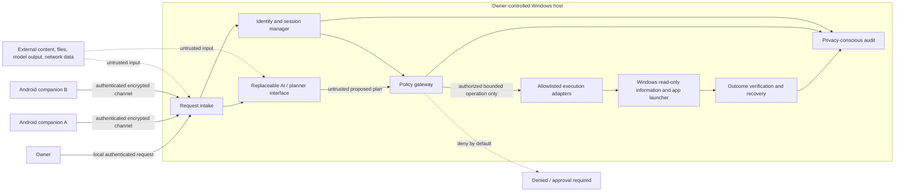
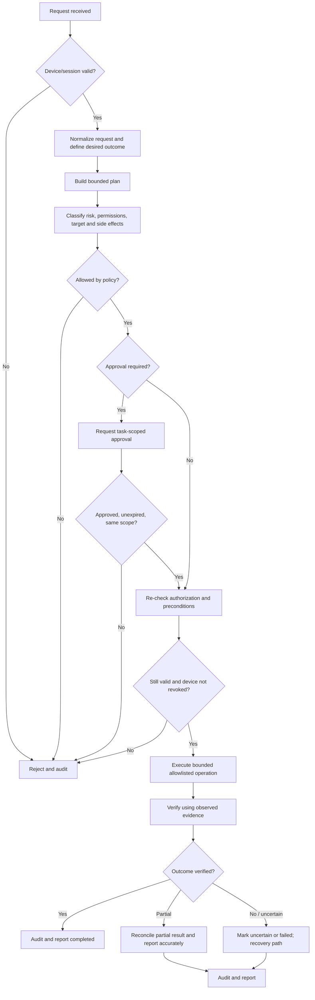
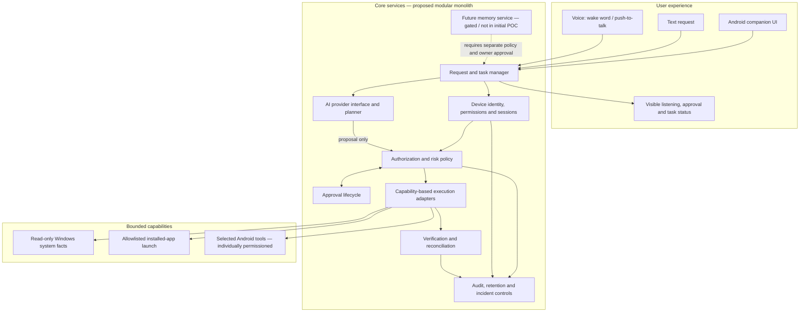
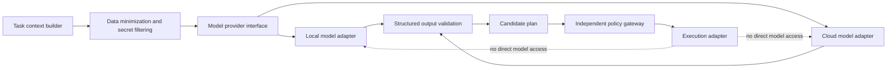
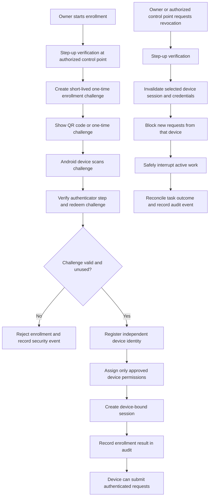
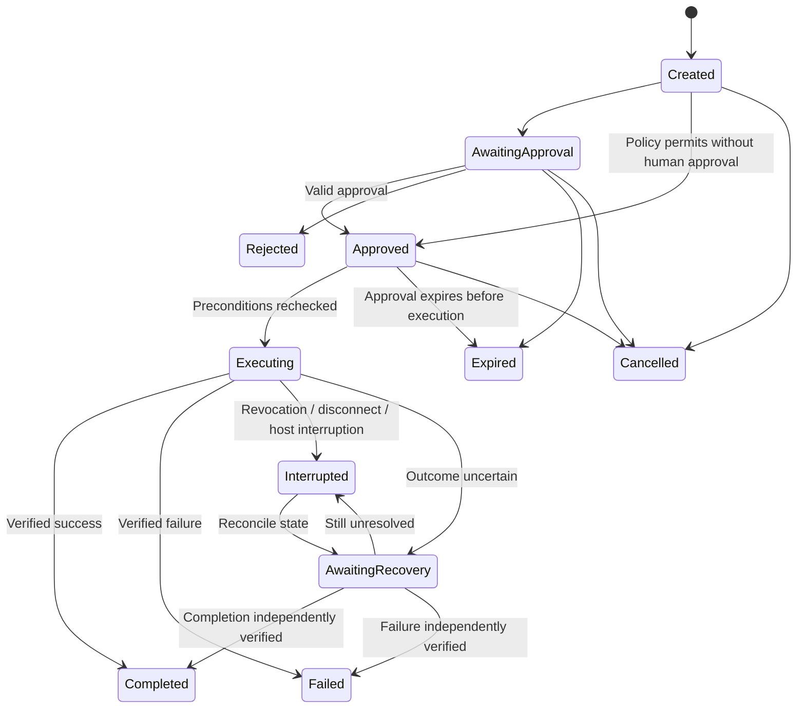
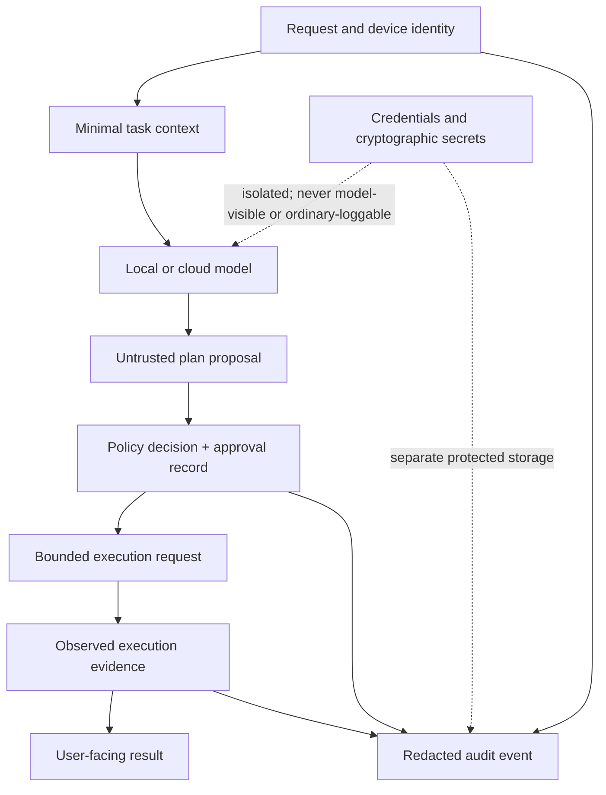
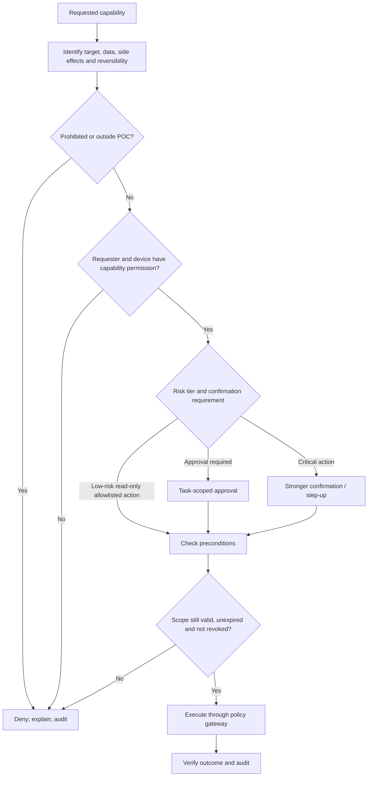
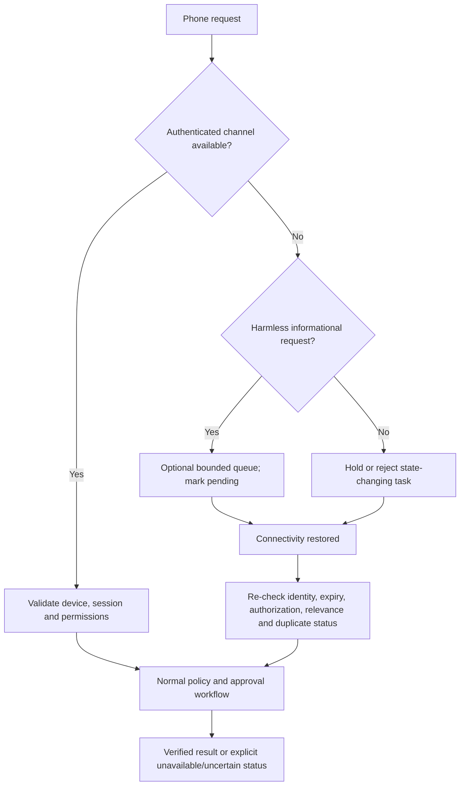
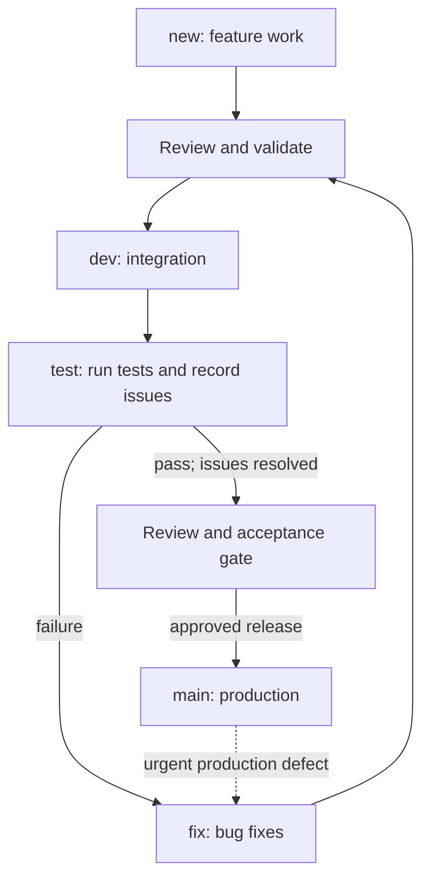

# JARVIS

**Personal AI assistant — security-first, modular, cross-device.**

JARVIS is planned as a privacy-conscious personal assistant for a Windows laptop and Android companion devices. The project is currently in the **POC planning stage**. Technology choices and detailed implementation decisions remain open where noted below.

> **Status:** Planning only. No application code has been approved or started. Implementation must not begin until the owner gives separate explicit approval.

## POC goal

Prove one secure, end-to-end workflow across the Windows host and an enrolled Android companion:

1. Enroll and authenticate a device.
2. Establish an authenticated, encrypted connection.
3. Receive a user request and translate it into a bounded action plan.
4. Apply policy checks and obtain task-scoped approval when required.
5. Execute only an explicitly permitted, limited operation.
6. Verify the outcome using evidence from the host.
7. Record a privacy-conscious audit event and report the actual result.

The first POC should favor a small, demonstrably secure workflow over broad assistant capabilities. Initial Windows actions are limited to **read-only system information and selected installed-app launching**. Launching an application does not authorize sensitive actions inside it.

## Proposed architecture

A **modular monolith** is the starting architecture proposal. Modules should have clear interfaces so components can be replaced or tested independently.

- **Request intake:** Accepts owner and companion requests.
- **Device identity and sessions:** Maintains independent identities, keys, sessions, permissions, and revocation for each enrolled phone.
- **AI/planner interface:** Allows evaluation of one local model and one cloud option. Models are advisory only and never receive execution authority.
- **Policy gateway:** Enforces default-deny authorization, least privilege, risk classification, preconditions, approvals, and revocation. All state-changing execution must pass through this gateway.
- **Execution adapters:** Expose a small allowlist of host operations rather than unrestricted shell access.
- **Verification and recovery:** Checks observed outcomes, handles interruption, and reconciles uncertain or partial results.
- **Audit and configuration:** Records security-relevant decisions and outcomes while minimizing personal data and redacting secrets.

Technology, storage, networking, and Windows/Android implementation choices are **not yet finalized**. Compare options with small experiments before selecting them.

## Security principles

- Default-deny access; least privilege; owner authority; no self-elevation by delegated administrators or AI.
- A model, external content, files, scripts, and network responses are untrusted inputs.
- Approvals are task-scoped and bound to the device, requested outcome, permitted actions/resources, risk level, and expiry. Material scope changes require new approval.
- Critical actions require stronger confirmation. Voice recognition and a wake word are not authentication.
- Device revocation must immediately prevent new authorized actions from that device; active work must stop safely and be reconciled.
- Offline queues are limited to harmless informational requests. State-changing work must be revalidated before execution; unsafe or non-idempotent actions must never be blindly replayed.
- No administrator elevation. If an operation requires it, stop and explain.
- No unrestricted terminal or script execution. Unknown commands, unsafe arguments, unexpected chaining, and out-of-scope targets are denied.
- File changes are limited to explicitly approved workspaces. Deletion should use a recoverable quarantine where feasible; permanent deletion requires explicit confirmation.
- Secrets must never be exposed to AI models or written to ordinary logs. No telemetry by default.
- If authorization or audit integrity is suspect, fail closed for state-changing actions, preserve available evidence, and notify the owner.
- Financial capabilities are excluded: no bank access, payments/transfers, trading or investment transactions, or financial authentication. These cannot be enabled by broad owner approval.

## Device and connectivity plan

- Windows laptop is the primary host; WSL/Linux is optional and will be evaluated against dependency needs.
- Android starts as a companion with selected phone tools, not unrestricted device access.
- The design should support two Android phones, each with independent identity, keys, sessions, permissions, and immediate revocation.
- Enrollment is proposed to combine a short-lived, one-time QR flow with authenticator verification. TOTP apps (Google/Microsoft Authenticator) and passkeys/security keys will be evaluated; TOTP alone is not authorization.
- Enrollment and revocation are controlled from the owner laptop or an authorized phone with step-up verification.
- Evaluate private VPN/overlay, outbound relay, and local-plus-remote relay approaches. No public unrestricted remote endpoint is planned.
- When the laptop is asleep or unavailable, attempt wake only where supported; otherwise report that it is unavailable. Do not claim an action succeeded without verification.

## POC scope

**Included**
- Security and device-identity foundation.
- One Android companion enrollment and authenticated request path, designed to extend to a second phone.
- Limited read-only Windows information.
- Selected installed-app launching.
- Policy checks, task-scoped approvals, expiry, rejection, and revocation handling.
- Audit events, verification, interruption handling, and basic recovery tests.
- Replaceable local/cloud AI interface, evaluated without granting models execution authority.
- Documentation, threat model, test plan, and traceability from requirements to tests.

**Out of scope for the initial POC**
- Administrator elevation or unrestricted shell access.
- Arbitrary script execution or broad file modification.
- Permanent deletion without explicit confirmation.
- Autonomous sending of messages or submitting forms.
- Broad Android permissions or unrestricted phone control.
- Scheduled autonomous automation and persistent memory until their approval, retention, and deletion policies are implemented.
- Publicly exposed, unrestricted remote access.
- All financial access, authentication, and transactions.

## Acceptance criteria

The POC is acceptable only when documented tests demonstrate that:

- An unregistered, revoked, expired, or unauthorized device cannot perform protected actions.
- Expired, reused, rejected, or scope-expanded approvals cannot authorize execution.
- AI output cannot bypass the policy gateway or grant itself permissions.
- Prohibited actions and out-of-scope commands are denied.
- Revocation prevents new actions immediately and active work is safely interrupted and reconciled.
- Interrupted or disconnected state-changing tasks are not blindly replayed.
- Results are reported as successful only when verified; uncertain and partial outcomes are clearly identified.
- Secrets are absent from model inputs and ordinary audit logs.
- Audit and recovery behavior is tested, including suspected integrity failure.
- Unit, integration, security-abuse, end-to-end, and recovery tests pass; resource usage is measured against thresholds agreed before implementation.

## Planning deliverables before implementation

1. Requirements baseline and open-decision register.
2. Threat model and trust boundaries.
3. Architecture and request-flow diagrams.
4. Risk, permissions, and approval matrix.
5. Technology comparisons and proof-of-concept experiments.
6. Windows/Android environment and dependency plan.
7. Test strategy, acceptance thresholds, and requirements-to-test traceability matrix.
8. Recovery, setup, and operations documentation.

## Open decisions

- Windows account/isolation model and host-side execution boundary.
- Risk tiers and which actions require approval or stronger confirmation.
- Network approach and remote connectivity behavior.
- Windows and Android technology stack.
- Local/cloud model candidates and privacy controls.
- Storage, audit integrity, backup, retention, and verified deletion design.
- Session expiry, enrollment-token lifecycle, and recovery-code storage.
- Performance/resource thresholds and the exact first vertical-slice scenarios.

## Approval gate

**This repository currently documents the proposed POC only. Do not start application coding until the owner explicitly approves implementation as a separate step.** Resolve or explicitly accept the relevant open decisions before committing to implementation choices.

---

# Architecture, workflows, feature maps, and design diagrams

> These are **planning diagrams**, not a claim that the system is implemented. They capture the current intended boundaries and workflows. Technology choices and unresolved design details remain provisional. GitHub renders the Mermaid diagrams below directly in this README; no separate image assets are required.

## 1. System context and trust boundaries

**Boundary rule:** neither the AI model nor a companion phone can call the execution adapter directly. The policy gateway is the mandatory enforcement point. The network path (private overlay, outbound relay, or hybrid) remains undecided.

## 2. End-to-end request workflow

**Invariant:** a request is not successful merely because a command was dispatched. The result must be verified; unknown outcomes are reported as unknown, interrupted, or partial.

## 3. Component and feature map

| Feature area | POC status | Boundary |
|---|---|---|
| Device enrollment and identity | In scope | Independent identity per phone; revocation supported |
| Read-only Windows information | In scope | Explicit allowlist; no broad machine inspection |
| Launch selected installed apps | In scope | Launch only; no authority over actions inside the app |
| Approval and policy gateway | In scope | Default-deny; task-bound approvals |
| Verification and audit | In scope | Evidence-based outcomes; redact secrets |
| Local/cloud AI comparison | Evaluate in POC | Advisory planner only; no direct execution |
| Voice interface | Later / design consideration | Wake word and voice are not authentication |
| Selected Android phone tools | Limited initial scope | Each permission granted separately |
| Persistent memory | Deferred | Requires approval, retention, privacy and deletion design |
| Automation, broad file operations, unrestricted terminal | Excluded initially | Separate future scope and security review required |
| Financial access or transactions | Prohibited | Not enabled by broad approval |

## 4. AI and model-provider design

### Model contract

- **Input:** only the minimum task context approved for that request; secrets and unrelated personal data are excluded.
- **Output:** a proposed structured plan, explanation, and uncertainty indicators—not commands with inherent authority.
- **Validation:** schema, allowed operation identifiers, parameter bounds, target scope, and size limits are checked before policy evaluation.
- **Authorization:** performed independently of the model by the policy gateway using the authenticated requester, device permissions, risk classification, approvals, and current preconditions.
- **Provider choice:** one local candidate and one cloud candidate will be compared experimentally. Names, model versions, hardware requirements, latency limits, and cloud disclosure rules are not yet finalized.
- **Failure behavior:** malformed output, provider failure, low confidence, unavailable connectivity, or policy ambiguity must not trigger an unsafe fallback or execution.

## 5. Device enrollment, session, and revocation workflow

The diagram below uses a standard Mermaid flowchart for broad renderer compatibility.

**Enrollment constraints**

- Each phone has its own identity, keys, session, permissions, and revocation state.
- The enrollment challenge is short-lived, single-use, and rejected if expired or already redeemed.
- Reinstalling the companion app requires re-enrollment.
- TOTP authenticator verification is not authorization by itself. Passkeys/security keys and authenticator options remain technology decisions.
- Enrollment and revocation are available only through the owner laptop or an authorized phone with step-up verification.
- Revocation must prevent new actions immediately. Any in-flight action is safely interrupted and reconciled; irreversible side effects are not assumed to be reversible.
- The exact QR payload, cryptographic key exchange, session expiry, and recovery protocol are not finalized.

## 6. Approval lifecycle and revocation semantics

Approval must be bound to **requester/device, intended outcome, allowed actions and targets, risk tier, expiry, and confirmation strength**. A changed plan or expanded scope requires a new approval. Revocation immediately blocks new actions; in-flight work is interrupted safely, then reconciled. Rollback is attempted only when supported and safe—irreversible side effects cannot be assumed reversible.

## 7. Data flow and trust classification

| Data category | Intended handling | Must not happen |
|---|---|---|
| Request content | Use for the active task; minimize retained content | Unnecessary retention or unrelated disclosure |
| Device identity and session material | Protected, device-scoped, revocable | Sharing credentials between phones |
| Model context | Minimum necessary; cloud sharing disclosed per task | Include secrets or grant execution authority |
| Proposed plan | Treat as untrusted until validated and authorized | Execute model output directly |
| Approval record | Bind to exact task scope, device, expiry and risk | Reuse for materially changed work |
| Audit events | Record security decisions, action IDs, outcomes and failures; redact secrets | Store passwords, tokens, or unnecessary personal content |
| Memory | Deferred until explicit approval and lifecycle controls exist | Save secrets or sensitive data by default |
| Backups | Encrypt local backup; keep device/credential secrets out of ordinary backups | Treat ordinary backup as a credential vault |

## 8. Permission and risk decision map

Risk tiers and the exact action-to-approval mapping are **open decisions**. This diagram defines the decision sequence, not final risk assignments. The initial POC should include only narrowly scoped, low-risk read-only operations and selected app launches, with approval/revocation paths tested.

## 9. Connectivity and offline behavior

No blind replay of non-idempotent or destructive work. If the laptop cannot be reached or woken, the user receives an unavailable status rather than a fabricated success. Wake capability is hardware, OS, power-state, and network dependent and must be tested.

## 10. Requirements-to-test traceability map

| Requirement ID | Requirement area | Verification evidence / test family |
|---|---|---|
| SEC-01 | Unknown, invalid, expired or revoked device denied | Security-abuse and integration tests |
| SEC-02 | Task-scoped approvals cannot be reused or expanded | Approval lifecycle tests |
| SEC-03 | AI cannot bypass policy or grant permissions | Adversarial planner and gateway tests |
| SEC-04 | No administrator elevation or unrestricted execution | Negative tests against execution adapters |
| SEC-05 | Revocation blocks new actions and interrupts active work | Concurrency and interruption tests |
| SEC-06 | Secrets excluded from model context and ordinary logs | Data-flow review and automated redaction tests |
| FLOW-01 | Request follows identity → policy → execution → verification | End-to-end happy-path and denial-path tests |
| FLOW-02 | Uncertain outcomes are not reported as success | Fault injection and reconciliation tests |
| FLOW-03 | Disconnected tasks are revalidated; no unsafe blind replay | Offline/reconnect and duplicate-request tests |
| AUD-01 | Security decisions and outcomes are auditable | Audit completeness, integrity and retention tests |
| REC-01 | Recovery behavior works after interruption or suspected integrity failure | Recovery drills and incident scenarios |
| PRIV-01 | Cloud context is minimized and disclosed per task | Data minimization review and provider-boundary tests |
| SCOPE-01 | POC remains within approved capabilities | Scope-negative tests and acceptance checklist |

These IDs are proposed traceability labels for planning and must be reconciled with the final requirements baseline before implementation. Test thresholds, resource budgets, and complete test cases remain to be agreed.

## 11. Suggested repository documentation map

As the planning work matures, split large documents into dedicated files and link them here:

- `docs/requirements.md` — requirements baseline, priorities, open decisions.
- `docs/architecture.md` — module boundaries, deployment/context diagrams, interface contracts.
- `docs/threat-model.md` — assets, trust boundaries, threat scenarios, mitigations.
- `docs/permissions-and-approvals.md` — risk tiers, capability matrix, approval lifecycle.
- `docs/data-and-privacy.md` — data categories, retention, cloud disclosure, deletion and backup.
- `docs/connectivity-and-devices.md` — enrollment, session lifecycle, connectivity alternatives, revocation.
- `docs/testing-and-acceptance.md` — test cases, traceability, measurable acceptance thresholds.
- `docs/technology-decisions.md` — experiments, comparisons, chosen options and rationale.

These are proposed future planning documents; this README update does not create those files or application code.

## 12. Git branching strategy

The initial repository workflow uses five long-lived branches. Additional short-lived branches may be created when a task requires isolation.

| Branch | Role | Usage and merge policy |
|---|---|---|
| `main` | **Production** | Default branch containing stable, reviewed, release-ready work. Merge from `dev` only after required tests and acceptance checks pass. |
| `dev` | **Developer integration** | Shared integration branch that combines completed work from `new`, `fix`, and validated changes from `test`. Keep it integration-ready. |
| `fix` | **Debugging and bug fixes** | Investigate and correct defects in existing code. Keep fixes focused, document the cause and verification, then merge into `dev`. |
| `test` | **Testing and audit evidence** | Validate changes and record test results, failures, reproducible issues, and relevant audit evidence. A passing test does not itself authorize a production release. |
| `new` | **New feature development** | Develop new features and stages in isolation. Review and test the work before merging into `dev`. |

### Standard flow

### Working rules

- Treat `main` as production and protect it from direct routine commits.
- Use pull requests/reviews and automated checks where repository settings permit.
- Record test outcomes and issue references so failures can be reproduced and traced.
- Merge only validated changes into `dev`; merge `dev` into `main` only after release checks and explicit acceptance.
- For urgent production fixes, create a narrowly scoped temporary hotfix branch from `main`, validate it, and merge the fix back into both `main` and `dev` as appropriate.
- Create task-specific branches such as `feature/<short-name>`, `bugfix/<short-name>`, `hotfix/<short-name>`, or `experiment/<short-name>` when useful. These supplement, rather than replace, the five core branches.
- Branch names describe workflow; they do not replace authorization, code review, test evidence, or the project's implementation approval gate.
- This branch strategy is for repository workflow only. **It does not approve starting JARVIS application coding.** The separate explicit owner approval gate remains in force.

## 13. Reusable free-resource directory

These resources are an approved **optional shortlist for JARVIS and future projects**. Use them when they improve the task; they are not mandatory dependencies. Check current availability, terms, licenses, attribution requirements, security, compatibility, and free-tier limits before integrating anything. Prefer official source files and minimal dependencies.

| Resource | Intended use | Integration guidance |
|---|---|---|
| [Iconify](https://icon-sets.iconify.design/) | Icons and technology logos | Verify the license of the specific icon set; prefer official brand assets where accuracy matters. |
| [unDraw](https://undraw.co/illustrations) | SVG illustrations for onboarding, empty states, and help screens | Check the current license and customization rules before use. |
| [ManyPixels design blog](https://www.manypixels.co/blog/social-media-design) | Visual inspiration and layout references | Treat as inspiration; do not assume all showcased assets are reusable. |
| [21st.dev](https://21st.dev/) | UI component discovery and examples | Inspect source, dependencies, accessibility, license, and free-tier limits before adoption. |
| [Haikei](https://haikei.app/) | Generated SVG backgrounds and decorative shapes | Prefer optimized static SVGs when animation is unnecessary. |
| [Manus](https://manus.im/) | Optional research or agent-workflow experiments | Use only if current free access and data handling fit the task; never provide secrets or unrestricted repository access unnecessarily. |
| [Motion Primitives](https://motion-primitives.com/) | Animation and interaction components | Check framework compatibility, accessibility/reduced-motion behavior, and added bundle cost. |
| [WebsitePrompts.ai](https://websiteprompts.ai/) | Prompt ideas for website/UI exploration | Adapt prompts to project requirements; prompts do not replace requirements or security review. |
| [CodeFronts](https://codefronts.com/) | Frontend code/resource discovery | Verify source quality, license, and maintenance before reuse. |
| [3Dicons](https://3dicons.co/) | Optional 3D icons and visual assets | Check each asset's license and performance impact; avoid unnecessary 3D in the POC. |
| [roadmap.sh](https://roadmap.sh/) | Learning paths and technical topic maps | Use as a learning reference, not as a substitute for project-specific architecture decisions. |
| [Uiverse](https://uiverse.io/) | Community UI components and interaction ideas | Review copied code for safety, accessibility, dependencies, and license. |
| [QuickRef](https://quickref.me/) | Syntax, command, and developer cheat sheets | Verify important commands against official documentation before running them. |
| [readme.so](https://readme.so/) | README structure and drafting | GitHub remains the canonical repository and source of truth. |
| [Resumake](https://resumake.io/) | Resume creation for non-core project tasks | Not a JARVIS runtime dependency. |
| [CodePen](https://codepen.io/) | Small, isolated browser/UI experiments | Keep experiments separate from production code; inspect external scripts and dependencies. |
| [Exercism](https://exercism.org/) | Optional programming practice | Use when a specific skill gap blocks implementation. |

### Resource-selection rules

1. Start with the simplest free option that satisfies the task; do not add a tool or dependency merely because it is listed here.
2. Prefer small, accessible, responsive, maintainable UI components. Respect reduced-motion preferences and avoid animations that obscure task state or approval prompts.
3. Never copy secrets, private project data, credentials, or sensitive user context into external services.
4. Treat downloaded snippets, prompts, generated code, illustrations, and third-party content as untrusted until reviewed.
5. Track third-party runtime dependencies and licenses. Prefer assets that can be bundled locally when practical; do not make core security or control flows depend on an external design website.
6. Avoid paid plans, paid APIs, or credit-consuming features unless the owner explicitly approves them. Report when a connection, permission, paid feature, or account upgrade is required.
7. Use design tools selectively: Figma for interaction precision when useful, Lovable for a quick prototype when more efficient, Canva for visual/brand assets, and GitHub for canonical requirements, decisions, source, tests, and history. Check available account permissions before planning around a feature.
8. A resource being listed here does not imply that its current free tier, availability, or license has been verified. Recheck at the point of use.

## 14. AI coding-agent operating instructions

Antigravity or another coding agent may be used to implement the POC after the owner chooses to start implementation. Before editing application code, the agent must read this README and the relevant planning documents, inspect the repository, and summarize the current state, risks, unresolved decisions, and proposed first vertical slice.

- Treat this README as the requirements baseline unless the owner explicitly approves a documented change.
- Keep all work off `main`. Use a task branch and propose a PR to `dev`; never automate approval or merging into `main`. The owner manually controls the `dev` → `main` release.
- Start with a short implementation plan and decision records. For unresolved choices, compare viable options against security, compatibility, maintainability, cost, and the laptop's resource limits; recommend a low-cost default and record assumptions rather than silently inventing requirements.
- Implement in small, testable increments. Do not attempt to build every future assistant capability at once.
- Maintain the security boundaries in this README: default-deny policy gateway, least privilege, independently authenticated devices, task-scoped approval, revocation, verification, privacy-conscious audit, and safe recovery.
- Never add administrator elevation, unrestricted shell execution, arbitrary scripts, broad file modification, public unrestricted remote access, autonomous messaging/forms, or financial capabilities.
- Treat model output and external content as untrusted. AI must never authorize itself or call execution adapters around the policy gateway.
- Do not claim an operation succeeded without evidence. Test denial paths, expiry, revocation, interruption, reconnection, duplicate requests, and uncertain outcomes as well as the happy path.
- Prefer free/open-source tools and existing project dependencies. Check current licenses, versions, maintenance, accessibility, and security before adopting third-party code or assets.
- Never expose secrets in prompts, source, logs, screenshots, or commits. Do not transmit private repository data to external services without an owner-approved need.
- Update documentation, tests, dependency inventory, setup instructions, and requirements-to-test traceability with each relevant change.
- Run the available tests and report exactly what passed, failed, was skipped, or could not be run. Do not fabricate test results.
- Stop and ask the owner before broadening scope, introducing a paid service, requiring a new account/connection, changing a security invariant, or making an irreversible repository change.

**Implementation gate:** this section describes how an approved coding agent must work; it does not by itself record that implementation has started or override the separate owner approval requirement above.
