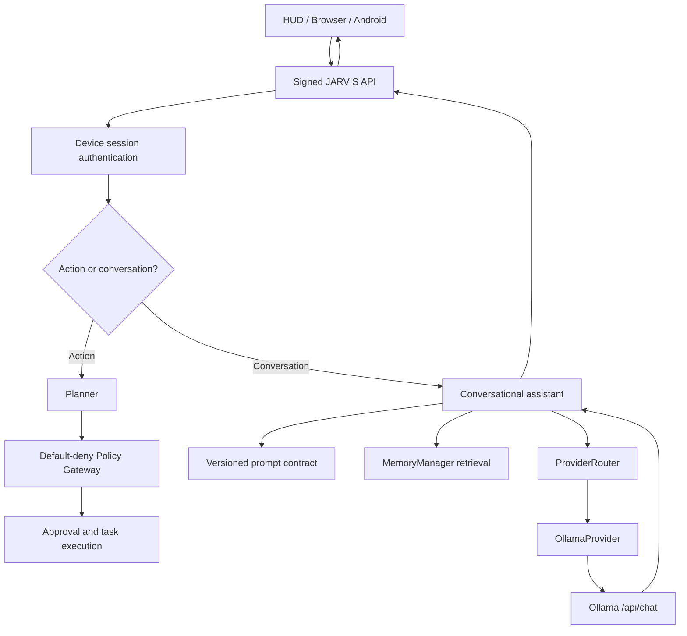

# JARVIS Ollama integration

## Configuration

The primary inference provider is the local Ollama service.

```dotenv
OLLAMA_URL=http://localhost:11434
OLLAMA_MODEL=llama3.2:latest
OLLAMA_TIMEOUT=120
```

The timeout is in seconds (1–600). Legacy `JARVIS_AI_BASE_URL` and
`JARVIS_AI_MODEL` values remain accepted as migration fallbacks. New deployments
should use the `OLLAMA_*` settings.

## Architecture



## Request flow

1. The client submits the existing signed `POST /api/request` request.
2. The server validates the device session and determines whether the text is an action.
3. Action requests continue to the existing planner and PolicyGateway without model execution.
4. Conversational requests retrieve bounded working-memory and authorized long-term context.
5. The versioned prompt contract builds the system/developer/user messages.
6. ProviderRouter selects local Ollama. The provider sends a non-streaming request to
   `POST /api/chat`, validates the response, and returns text to the existing response contract.
7. The existing response shape and conversation ID are preserved.

## Memory and retrieval flow

- Conversation history is isolated per authenticated device and conversation ID in the
  existing bounded process-local ConversationSessionStore.
- Working memory is short-lived and RAM-only.
- Long-term personal memories remain encrypted at rest in PersonalMemoryStore.
- MemoryManager ranks relevant memories using local Ollama embeddings plus lexical
  overlap and recency; it falls back to lexical retrieval if embeddings are unavailable.
- Retrieved content is supplied as untrusted context, never as system instructions.
- Learning candidates and feedback remain owner-reviewable; no automatic model fine-tuning occurs.

The current semantic retrieval covers stored personal memories. It is not a document
ingestion/vector-RAG pipeline; document RAG can be added later behind a separate retriever.

## Health checks

- Direct Ollama health: `GET http://localhost:11434/api/tags`
- JARVIS provider configuration: authenticated `GET /api/ai/providers`
- JARVIS Ollama connectivity/model check: authenticated `GET /api/ai/health`

The JARVIS endpoints require the existing signed device session and a device-management
permission. They do not expose Ollama credentials or unrestricted provider URLs.

## Tests

Run the provider unit tests with:

```powershell
npm test
```

Validate the locally installed model end-to-end:

```powershell
npm run test:ollama
# or
.scripts\test-ollama.ps1
```

## cURL examples

List installed models:

```bash
curl http://localhost:11434/api/tags
```

Send a native chat request:

```bash
curl http://localhost:11434/api/chat \
  -H "Content-Type: application/json" \
  -d '{"model":"llama3.2:latest","messages":[{"role":"user","content":"Reply with exactly: OLLAMA_OK"}],"stream":false}'
```

The authenticated JARVIS provider endpoints must be called through the existing signed
client; do not replace the signature headers with an unauthenticated request. In a logged-in
JARVIS browser session, use the existing device crypto helper:

```javascript
const response = await window.JarvisDeviceCrypto.signedFetch('/api/ai/health', { method: 'GET' });
console.log(response.status, await response.json());
```

## PowerShell API test

```powershell
$env:OLLAMA_URL = 'http://localhost:11434'
$env:OLLAMA_MODEL = 'llama3.2:latest'
$env:OLLAMA_TIMEOUT = '120'
.scripts\test-ollama.ps1
```

## Future self-learning path

Keep inference separate from learning. Future work can improve:

1. Conversation history persistence with explicit retention, export and deletion controls.
2. User-profile facts proposed from conversations, stored as attributed learning candidates.
3. Owner feedback (helpful/not helpful/correction) linked to the source interaction.
4. Retrieval over approved documents using a separate document collection and embedding index.
5. Evaluation datasets and retrieval-quality metrics before promoting any learning candidate.

Approved facts are stored in the encrypted memory store. Learning candidates require owner
approval. No online weight updates or automatic fine-tuning are part of this design.
