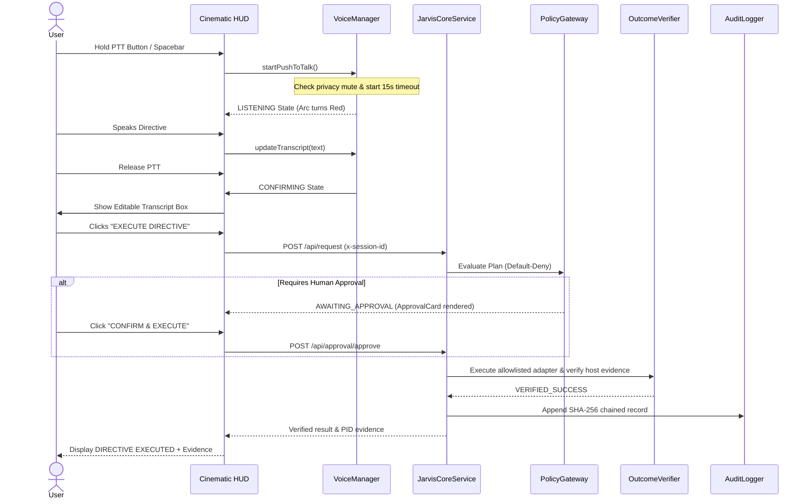

# JARVIS Cinematic HUD Component Inventory & Integration Guide

## 1. Overview
The **JARVIS Cinematic Windows HUD** is a responsive, futuristic interface accessible at `/hud` that connects directly to the authenticated JARVIS core backend. It establishes the visual and conversational foundation for the JARVIS Personal AI Assistant while adhering strictly to default-deny access control, zero-elevation execution boundaries, and push-to-talk privacy guarantees.

---

## 2. Reusable Component Inventory

| Component | Selector / ID | Visual State & Purpose | Connected Backend Endpoint |
|---|---|---|---|
| **AssistantHeader** | `.hud-header` | Displays JARVIS brand, OS version, live status dot, and security telemetry (`SYSTEM: WINDOWS 11`, `POLICY: DEFAULT-DENY`, `AUDIT HASH: CHAIN OK`, `HOST LINK`). | `GET /api/status` |
| **AssistantVisualizer** | `#reactor-container` | Multi-ring rotating Arc-Reactor with central glowing core and interactive audio waveform canvas. Turns red when capturing audio or processing. | Local Web Audio / Canvas |
| **StatusBanner** | `#hud-state-label` | Real-time state indicator reflecting true backend states: `IDLE`, `LISTENING`, `CONFIRM DIRECTIVE`, `PROCESSING`, `AWAITING CONSENT`, `EXECUTING`, `COMPLETED`, `FAILED`, and `HOST OFFLINE`. | Core Service Lifecycle |
| **PushToTalkControl** | `#btn-ptt` | Push-to-talk button supporting mouse hold, touch hold, core-click, or `Spacebar` press. Features a 15-second automatic timeout safety limit. | `VoiceManager` client |
| **MicrophonePrivacyControl** | `#btn-toggle-mic-mute` | Hardware privacy mute control (`MIC: ARMED` / `MIC: MUTED`). Hard-disables microphone access; rejects any push-to-talk attempts when muted. | `VoiceManager.toggleMute()` |
| **ReducedMotionToggle** | `#btn-toggle-motion` | Accessibility control toggling high-frequency CSS ring rotations and canvas waveform animations. | Local DOM Class |
| **TranscriptConfirmation** | `#transcript-box` | Editable text field displaying transcribed speech before dispatch. User can edit the text or click `DISCARD` (`Esc`). | Client Validation |
| **AuthenticatedEnclavePanel** | `.hud-panel-left` | Displays enrolled device name (`Windows 11 HUD Enclave`), device ID, permission risk meter (`LOW`, `MED`, `HIGH`), and live audit ledger stream. | `POST /api/hud/session`, `GET /api/audit` |
| **TaskGovernancePanel** | `.hud-panel-right` | Displays pending approval cards with exact task scope, risk tier, and single-use `CONFIRM & EXECUTE` / `DENY` controls. | `POST /api/approval/approve`, `POST /api/approval/reject` |
| **ExecutionEvidenceFeed** | `#hud-tasks-feed` | Chronological feed of verified execution outcomes with tasklist PID evidence and timestamps. | `POST /api/request` |
| **CommandDeck** | `.hud-footer` | Quick allowlisted directive chips (OS Specs, RAM, Battery, Disk Space, Launch Notepad, Launch Calc, Adversarial Test) and high-speed terminal text input. | `POST /api/request` |

---

## 3. Push-To-Talk Voice Interaction Flow

---

## 4. Privacy Invariants & Security Boundaries
1. **Zero Continuous Capture**: The microphone is never activated on application load.
2. **Zero Wake-Word Detection**: Preserves privacy invariants; spoken phrases are not authentication.
3. **Editable Transcript Confirmation**: Spoken input is explicitly presented for review before dispatch to prevent accidental command dispatch.
4. **Local Loopback Enforcement**: `/api/hud/session` is restricted to local loopback addresses (`127.0.0.1`, `::1`).
5. **Fail-Closed Execution**: If audit chain integrity fails or the device is revoked, all state-changing actions halt immediately.
