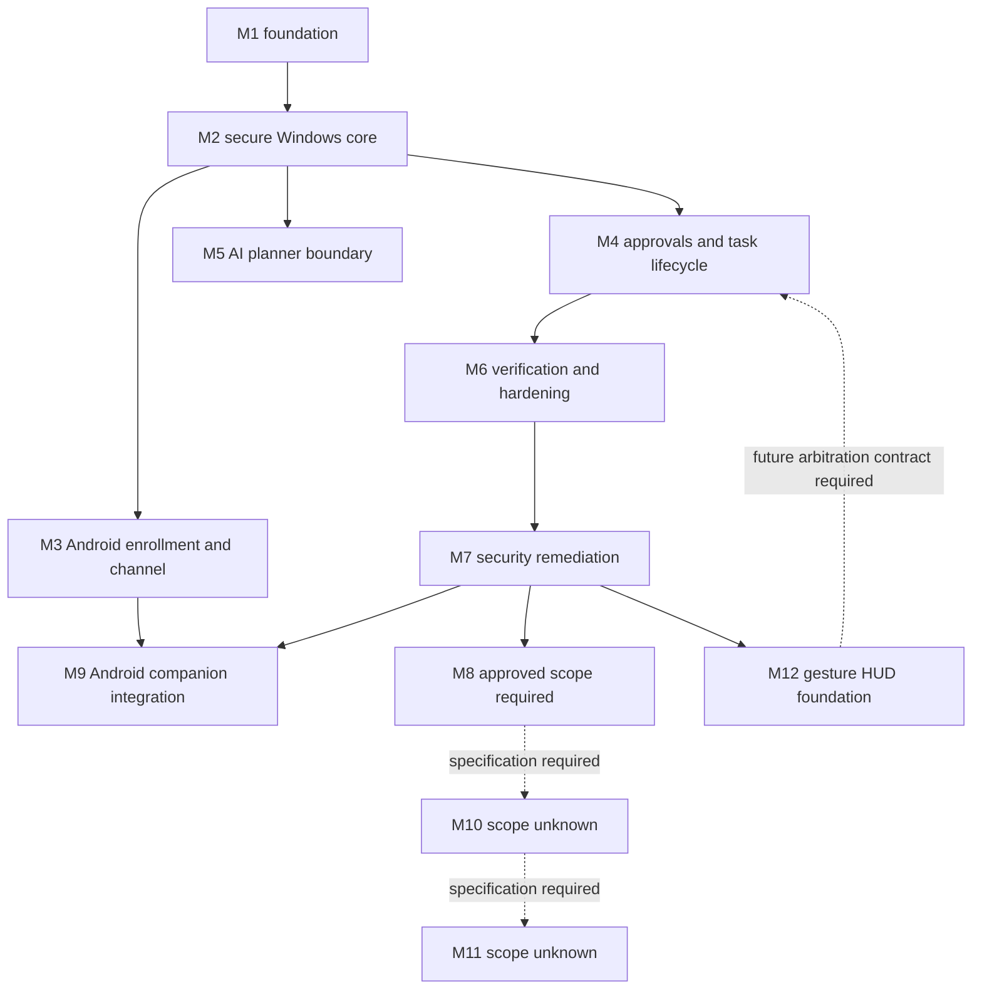

# Milestone dependency map

This map records integration dependencies visible in the current architecture;
it does not define missing product scope. Resolve approved milestone
specifications before implementation.

M12 currently ends at local HUD proposal/preview and does not feed the shared
command router or policy gateway. Any future action integration must depend on
the existing authentication, policy, approval, and audit contracts. M8, M10,
and M11 edges are placeholders for planning only; no scope is inferred.

## Integration rules

- Shared identity, policy, approval, command routing, API contracts, and audit
  foundations have a single implementation owner in the integration path.
- Feature work is reviewed on an authorized working branch and integrated into
  `dev` only through the repository's reviewed PR process.
- `main` remains human-controlled. Worktree existence is not milestone evidence.
